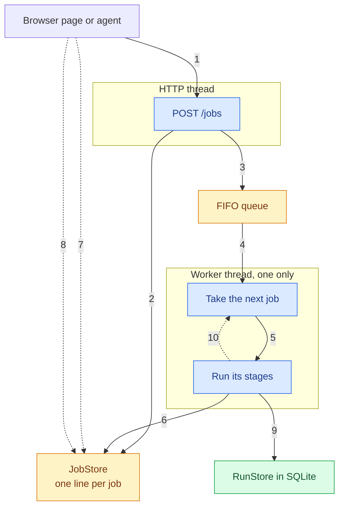

# Architecture

The macro technical shape: the stack, how the pieces fit, and the decisions behind them. Point to the code, do not restate it. The full decision record, with alternatives and measures, is `aidd_docs/memory/internal/decisions/stack.md`.

## Stack

- Python and FastAPI for the backend, because faster-whisper is Python and a second runtime would need a bridge.
- One page with vanilla JS and Tailwind through its Play CDN, split into `index.html`, `theme.css` and `app.js`, served by FastAPI from `/` and `/static`. No front build. See `internal/decisions/page-files.md`.
- faster-whisper with the `large-v3-turbo` model in float16, called inside the API process.
- yt-dlp with `deno` for the audio download, and for the video-only stream when a job captures frames. No ffmpeg, PyAV decodes the audio and the video, and numpy compares the images.
- Docker Compose with an NVIDIA GPU reservation and a healthcheck on `GET /`.

## How it fits together

Two threads share one in-memory `Job` per request. The HTTP thread creates it and queues it, the single worker thread runs it, and the caller reads it. The same `Job` object sits in the queue and in `JobStore`, so what the worker writes is what the caller reads.

Blue boxes run code, amber boxes are memory shared by both threads, green is the only storage that survives a restart.

1. The caller sends `POST /jobs` and gets `202` with the job id at once.
2. The HTTP thread creates the `Job` in `JobStore`, in the stage `queued`.
3. It puts the same `Job` at the end of the FIFO queue.
4. The worker takes the oldest job of the queue and restarts its time limit clock, so the wait is not counted.
5. It runs the stages: `downloading`, `transcribing`, then `extracting` when frames are asked.
6. At each stage it writes the stage, the progress and finally the text on the `Job` in `JobStore`. Nothing is copied, the caller sees the same object change.
7. The caller polls `GET /jobs/{id}` every 2 s, which reads `JobStore` and never touches the queue or the worker.
8. `POST /jobs/{id}/cancel` raises a flag on the `Job`. The worker reads it at its next checkpoint and ends the job in `error`.
9. Once the job ends, the worker writes the run to SQLite, then marks the `Job` `done` or `error`.
10. The worker goes back to the queue for the next job, or waits there while it is empty.

## Key decisions

- The model loads once at startup, in the FastAPI lifespan, and the page is served only after that.
- A job runs in the worker thread and the page polls every 2 s, so no request waits for minutes.
- One job at a time, because there is one GPU. `POST /jobs` always answers `202`: the job joins a FIFO queue (`queue.Queue`) read by one worker thread started in `create_app`, and stays `queued` until the worker takes it. The time limit clock restarts then, so waiting costs nothing. A job cancelled while it waits ends in `error` without a download, and the 20 jobs kept in memory are evicted only once finished. The queue is unbounded and a restart loses it, see `internal/decisions/job-queue.md`.
- A job cannot hold the GPU forever. Stopping is cooperative, a thread cannot be killed: each `Job` carries a cancel flag and a start time, and `Job.check()` raises `JobStopped` when the flag is set or `JOB_TIMEOUT_S` (900 s) is past. The checkpoints are the yt-dlp progress hook (an exception raised there leaves `extract_info` unwrapped, measured on yt-dlp 2026.08.19), the progress callback of the transcriber (called for every segment), the frame sampling loop and the gaps between stages. `work` turns `JobStopped` into a job and a run in `error`. During the capture only an explicit cancel does (`JobStopped.cancelled`): a time limit hit there keeps the job `done` with its transcript and no images, like a failed capture, logged as a warning. The stop is not instant: during transcription it waits for the next segment, during a yt-dlp network stall up to ~20 s (`DEFAULT_TIMEOUT`), and a cancel that lands as the job finishes can still end `done`.
- The running job lives in memory for its progress, the last 20 jobs are kept there, and a restart loses them. Every finished run, done or error, is written as one row of `runs` in SQLite (`app/runs.py`) with its telemetry, and a done run also writes its timed segments to the `segments` table in the same transaction (schema version 4, migrated step by step from version 1), see `internal/decisions/run-storage.md`. A storage failure is logged and never changes the job.
- The video info (title, channel, duration) comes from the `extract_info(download=False)` call that `download_audio` already makes, through an `on_info` callback, so no second network call. The job publishes it from the `downloading` stage. Hotwords are per job: `POST /jobs` may carry them, `Job.hotwords` holds the value used (request or `HOTWORDS` default), `Transcriber.run` receives it and `runs.settings.hotwords` records it. The `.txt` export is built in the page, no route.
- Frame capture is off by default. When a job asks for it (`level: "frames"` in `POST /jobs`, stored in `runs.level`), it runs after the transcription, in the stage `extracting`, in `app/frames.py`: video-only download, one sample per second, a screen kept once it stays stable, perceptual-hash dedupe, at most `MAX_FRAMES` images (`app/frames.py`), WebP files in `<db folder>/frames/<run_id>/` and one `frames` row each, in the same transaction as the run. The video is deleted. A capture failure is logged and leaves the job `done` without images (supposed choice, see the section "Choix faits dans #50" of `internal/decisions/frames-pyav.md`).
- Every job logs its start and its end with its id, and every failure with its traceback (`log.exception` in `work`, `app/main.py`), on stdout so `docker compose logs` shows them. `build_app` calls `setup_logging`, which gives the `app` logger a stdout handler at `INFO`, because uvicorn only configures its own loggers. The message returned by `GET /jobs/{id}` stays the short French one, without traceback.
- No language select. Whisper detects the language and translation is left to the downstream skill.
- yt-dlp is locked in `uv.lock` and upgraded at build, so a `--no-cache` rebuild still follows YouTube changes.
- A change that departs from the ADR needs a new ADR first.

## Gotchas

- PyAV is bounded to `>=15,<19`, a temporary bound: version 19 breaks faster-whisper 1.2.1 with a `metadata_errors` error. Lift it once faster-whisper or PyAV fixes it.
- `entrypoint.sh` computes `LD_LIBRARY_PATH` from `__path__`, because the `nvidia` packages are namespaces and their `__file__` is `None`.
- yt-dlp needs `deno`, without it YouTube hides formats.
- `build_app` is the uvicorn factory. Tests call `create_app` with fakes, so they import without a GPU.
