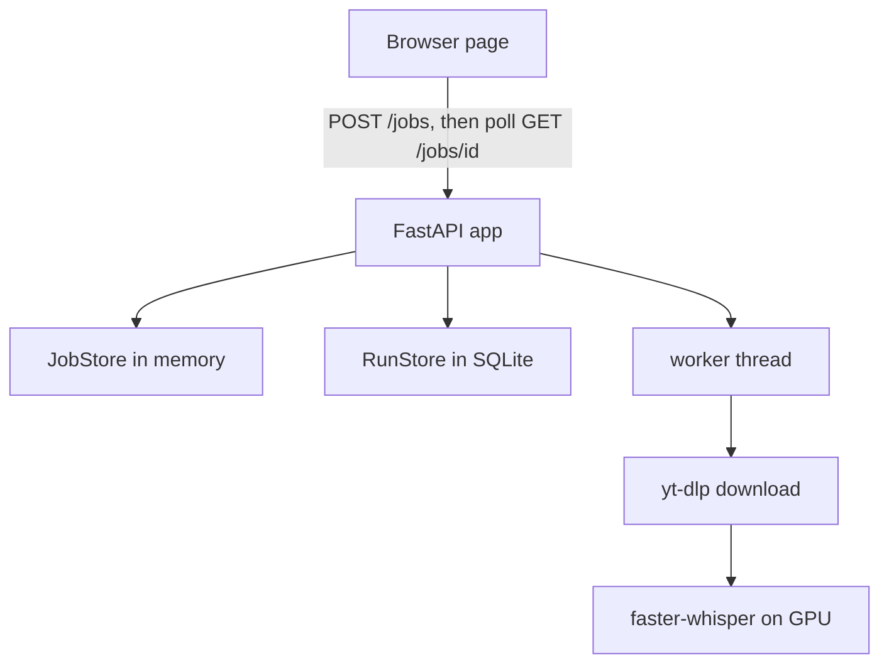

# Architecture

The macro technical shape: the stack, how the pieces fit, and the decisions behind them. Point to the code, do not restate it. The full decision record, with alternatives and measures, is `aidd_docs/memory/internal/decisions/stack.md`.

## Stack

- Python and FastAPI for the backend, because faster-whisper is Python and a second runtime would need a bridge.
- One page with vanilla JS and Tailwind through its Play CDN, split into `index.html`, `theme.css` and `app.js`, served by FastAPI from `/` and `/static`. No front build. See `internal/decisions/page-files.md`.
- faster-whisper with the `large-v3-turbo` model in float16, called inside the API process.
- yt-dlp with `deno` for the audio download, and for the video-only stream when a job captures frames. No ffmpeg, PyAV decodes the audio and the video, and numpy compares the images.
- Docker Compose with an NVIDIA GPU reservation.

## How it fits together

## Key decisions

- The model loads once at startup, in the FastAPI lifespan, and the page is served only after that.
- A job runs in a thread and the page polls every 2 s, so no request waits for minutes.
- One job at a time, because there is one GPU. The second request gets `409`.
- The running job lives in memory for its progress, the last 20 jobs are kept there, and a restart loses them. Every finished run, done or error, is written as one row of `runs` in SQLite (`app/runs.py`) with its telemetry, and a done run also writes its timed segments to the `segments` table in the same transaction (schema version 3, migrated step by step from version 1), see `internal/decisions/run-storage.md`. A storage failure is logged and never changes the job.
- Frame capture is off by default. When a job asks for it (`JobStore(frames=True)` for now, the choice per job comes with #51), it runs after the transcription in `app/frames.py`: video-only download, one sample per second, a screen kept once it stays stable, perceptual-hash dedupe, at most 80 images, WebP files in `<db folder>/frames/<run_id>/` and one `frames` row each, in the same transaction as the run. The video is deleted. A capture failure is logged and leaves the job `done` without images (supposed choice, see `internal/decisions/frames-pyav.md`).
- No language select. Whisper detects the language and translation is left to the downstream skill.
- yt-dlp is locked in `uv.lock` and upgraded at build, so a `--no-cache` rebuild still follows YouTube changes.
- A change that departs from the ADR needs a new ADR first.

## Gotchas

- PyAV is bounded to `>=15,<19`, a temporary bound: version 19 breaks faster-whisper 1.2.1 with a `metadata_errors` error. Lift it once faster-whisper or PyAV fixes it.
- `entrypoint.sh` computes `LD_LIBRARY_PATH` from `__path__`, because the `nvidia` packages are namespaces and their `__file__` is `None`.
- yt-dlp needs `deno`, without it YouTube hides formats.
- `build_app` is the uvicorn factory. Tests call `create_app` with fakes, so they import without a GPU.
