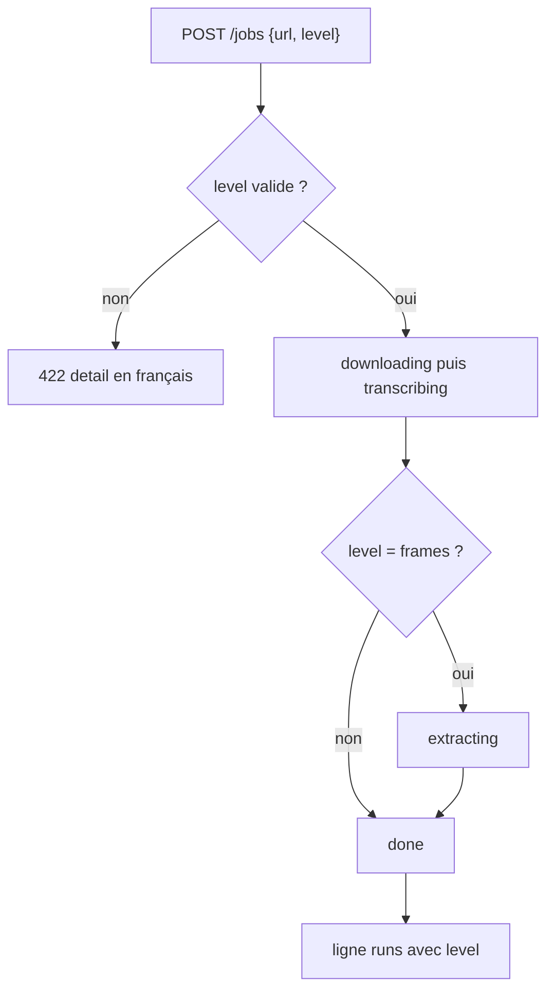
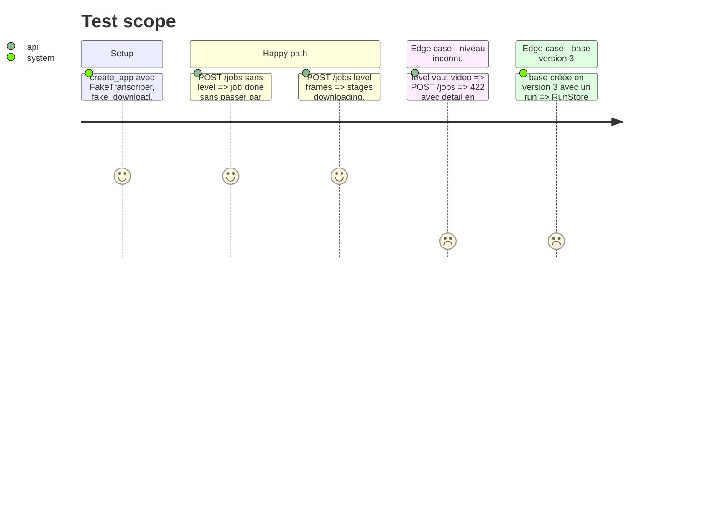

# Instruction: Niveau par job côté API, run et étape `extracting`

## Architecture projection

> Tree of the final files. ✅ create · ✏️ modify · ❌ delete

```txt
.
├── app/
│   ├── main.py      ✏️ JobRequest.level, validation 422, start(frames), étape extracting, level dans record
│   ├── jobs.py      ✏️ constante EXTRACTING, JobStore sans drapeau global, start(frames: bool = False)
│   ├── runs.py      ✏️ colonne level, schéma 4, level dans _COLUMNS et _SUMMARY_COLUMNS
│   └── fake.py      ✏️ FAKE_CAPTURE_DELAY = 3.0 attendu dans fake_capture
└── tests/
    ├── conftest.py  ✅ ou fixture autouse qui met FAKE_CAPTURE_DELAY à 0 (si absent, dans les fichiers concernés)
    ├── test_jobs.py ✏️ niveau par défaut, 422, passage par extracting, level dans le run, plus de JobStore(frames=True)
    └── test_runs.py ✏️ migration 3 vers 4, versions attendues passées à 4
```

## User Journey



## Test Scope



## Tasks to do

### `1)` Niveau par job dans le store

> Le choix des images se fait à chaque job.

1. Dans `app/jobs.py`, ajouter `EXTRACTING = "extracting"` aux étapes.
2. Retirer le paramètre `frames` de `JobStore.__init__` et son commentaire provisoire.
3. `JobStore.start(self, frames: bool = False)` crée le `Job` avec ce drapeau.

### `2)` Champ `level` dans `POST /jobs`

> L'API accepte et valide le niveau.

1. `JobRequest.level: str = "text"`, sans `Literal` pydantic : le 422 doit porter un `detail` en chaîne française, au format `{"detail": "..."}` comme les autres erreurs.
2. Dans `create_job`, après la validation d'URL, refuser toute valeur hors `{"text", "frames"}` avec un `422` en français, par exemple « Le niveau doit être text ou frames. ».
3. Appeler `store.start(frames=req.level == "frames")`.
4. Retirer le paramètre `jobs` de `create_app` s'il n'a plus d'usage dans les tests. Sinon le garder.

### `3)` Étape `extracting`

> L'extraction se voit dans `stage`.

1. Dans `work`, juste avant `capture_images`, appeler `store.set_stage(job, j.EXTRACTING)` quand `job.frames` est vrai, même si `runs.frames_dir` est `None`. Sans dossier, la capture reste sautée.
2. Passer `level="frames" if job.frames else "text"` à `runs.record`.

### `4)` Colonne `level` dans `runs`

> Le niveau est gardé dans le run.

1. `SCHEMA_VERSION = 4`, étape `if version < 4` : `ALTER TABLE runs ADD COLUMN level TEXT NOT NULL DEFAULT 'text'`.
2. La création neuve passe aussi par cette étape. Ne pas modifier `_RUNS_SCHEMA`, pour qu'il n'y ait qu'un seul chemin.
3. Ajouter `level` à `_COLUMNS` et à `_SUMMARY_COLUMNS`.

### `5)` Délai de la capture factice

> L'étape est observable dans l'e2e factice sans ralentir pytest.

1. `FAKE_CAPTURE_DELAY = 3.0` dans `app/fake.py`, et `time.sleep(FAKE_CAPTURE_DELAY)` au début de `fake_capture`.
2. Une fixture pytest met ce délai à 0 dans les tests qui utilisent `fake_capture`.

### `6)` Tests

> Chaque critère de l'issue côté API est prouvé.

1. `test_jobs.py` : remplacer `j.JobStore(frames=True)` par `{"url": ..., "level": "frames"}`.
2. Ajouter un test pour le job sans niveau : il ne passe jamais par `extracting`, son run vaut `level == "text"` et n'a pas de frames.
3. Ajouter un test pour le niveau `frames` : un espion sur `set_stage` voit `downloading, transcribing, extracting` dans l'ordre, et le run vaut `level == "frames"`.
4. Ajouter un test pour un niveau inconnu : `422`, un `detail` en français, et un second `POST` valide accepté ensuite (aucun job n'a été pris).
5. `test_runs.py` : ajouter un test de migration de 3 vers 4 qui garde les runs et les met à `level = 'text'`. Passer les `user_version` attendues de 3 à 4.
6. Vérifier que `GET /runs` porte `level` dans chaque résumé.

## Test acceptance criteria

| Task | Acceptance criteria |
| ---- | ------------------- |
| 1 | `JobStore()` ne prend plus d'argument, `start(frames=True)` crée un job qui capture |
| 2 | `POST /jobs` sans `level` répond `202` comme avant. `level: "video"` répond `422 {"detail": "<français>"}` |
| 3 | un job `frames` passe par `extracting` avant `done`, un job `text` jamais |
| 4 | une base en version 3 s'ouvre en version 4 sans perte, avec `level = 'text'` sur les anciens runs |
| 5 | `fake_capture` attend 3 s en mode `YT_FAKE=1`, 0 s dans pytest |
| 6 | `scripts/check.sh` passe, couverture au-dessus de 80 % |
