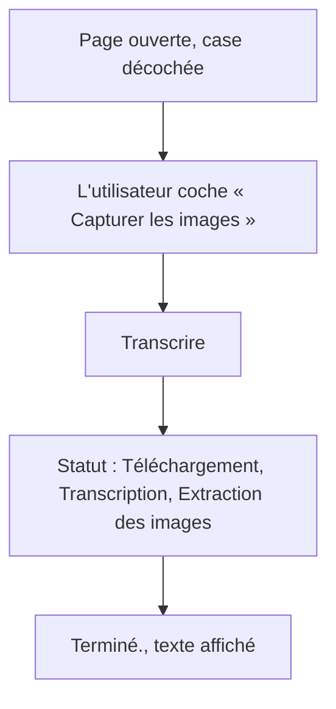
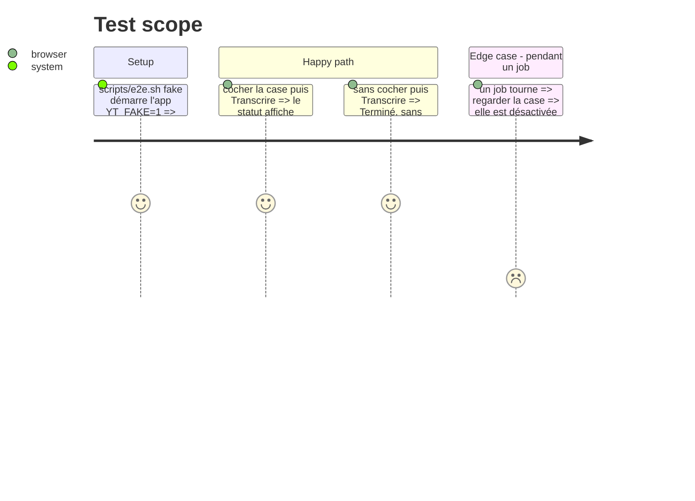

# Instruction: Case dans la page, scénario Playwright, mémoire et README

## Architecture projection

> Tree of the final files. ✅ create · ✏️ modify · ❌ delete

```txt
.
├── app/static/
│   ├── index.html   ✏️ case « Capturer les images » sous le champ URL
│   └── app.js       ✏️ level envoyé, étape extracting dans STAGES, case désactivée pendant un job
├── e2e/test_page.py ✏️ scénario du choix des images, RUNNING inclut l'extraction
├── README.md        ✏️ section API et paragraphe sur la capture
└── aidd_docs/memory/
    ├── api.md            ✏️ champ level, stage extracting, level dans les runs
    ├── forms.md          ✏️ case du niveau
    ├── architecture.md   ✏️ choix par job au lieu de JobStore(frames=True), schéma 4
    ├── testing.md        ✏️ huit scénarios e2e, délai de fake_capture
    ├── project-brief.md  ✏️ étape extracting dans Stage, fonction clé
    └── design.md         ✏️ libellé accessible de la case, si besoin
```

## User Journey



## Test Scope



## Wireframe

```txt
┌──────────────────────────────────────────────┐
│ (1) yt-transcriber                    [theme]│
├──────────────────────────────────────────────┤
│ (2) [ URL ........................ ][Transcrire]│
│ (3) [ ] Capturer les images                   │
│ (4) statut                                    │
│ (5) erreur                                    │
│ (6) ┌──────────────────────────────[⏱][⧉]┐   │
│     │ transcription                      │   │
│     └────────────────────────────────────┘   │
└──────────────────────────────────────────────┘
```

1. En-tête existant.
2. Formulaire existant, inchangé.
3. Nouvelle case à cocher avec son label, dans le `#form`, décochée par défaut.
4. Ligne de statut, qui gagne l'étape « Extraction des images ».
5. Ligne d'erreur existante.
6. Zone de texte existante.

## Tasks to do

### `1)` Case dans la page

> L'utilisateur choisit le niveau avant de lancer.

1. Dans `#form` de `index.html`, sous la ligne URL et bouton, ajouter `<input type="checkbox" id="frames">` dans un `<label>` « Capturer les images », avec les jetons du thème (`accent-action`, `text-muted` ou `text-ink`) et aucune classe de palette brute.
2. Le `#form` passe en colonne, ou bien la case va dans une ligne sous le flex existant, sans changer l'apparence de la ligne URL.

### `2)` Envoi du niveau et nouvelle étape

> La page envoie le choix et affiche l'extraction.

1. `app.js` : le corps du `POST` porte `level: $("frames").checked ? "frames" : "text"`.
2. `STAGES.extracting = "Extraction des images"`.
3. `setBusy(busy)` désactive aussi `#frames`.

### `3)` Scénario Playwright

> Le choix dans la page est couvert de bout en bout.

1. Ajouter `test_frames_choice_shows_the_extraction_step` dans `e2e/test_page.py`. Il coche `#frames`, soumet, attend « Extraction des images » dans `#status`, puis appelle `wait_done`.
2. Au niveau `fake` seulement (`e2e_level == "fake"`), vérifier aussi `GET /runs/latest` : `level == "frames"` et deux frames. Au niveau `real`, le nombre de slides dépend de la vidéo.
3. Le timeout d'attente de l'extraction couvre le niveau `real`, `DONE_TIMEOUT` étant déjà là.
4. Ajouter « Extraction » à la regex `RUNNING` pour que les scénarios existants restent justes.

### `4)` Mémoire et README

> Rien de ce qui est écrit ne devient faux.

1. `api.md` : le champ `level` de `POST /jobs` et son 422, `extracting` dans les valeurs de `stage`, `level` dans le résumé et le détail des runs.
2. `forms.md` : la case du niveau, décochée par défaut et désactivée pendant un job.
3. `architecture.md` : « choix par job » au lieu de `JobStore(frames=True)` et de la mention de #51, schéma version 4.
4. `testing.md` : huit scénarios au lieu de sept, avec le nouveau dans la liste, et le délai `FAKE_CAPTURE_DELAY` de `fake_capture`.
5. `project-brief.md` : `extracting` dans la ligne Stage, et une fonction clé « capture des slides au choix ».
6. `README.md` : la section API (`level`, `extracting`) et la ligne 38, qui annonce le choix pour #51.
7. `design.md` : ajouter la case seulement si elle change une règle d'accessibilité.

## Test acceptance criteria

| Task | Acceptance criteria |
| ---- | ------------------- |
| 1 | la case est visible sous le champ URL, décochée au chargement, lisible dans les deux thèmes |
| 2 | case cochée, le statut passe par « Extraction des images ». Case décochée, le comportement est celui d'avant |
| 3 | `scripts/e2e.sh fake` passe avec huit scénarios |
| 4 | aucun fichier de mémoire ni le README ne décrit encore `JobStore(frames=True)` ou un choix « à venir avec #51 » |
