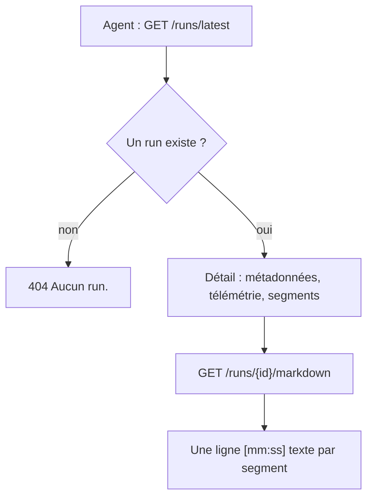
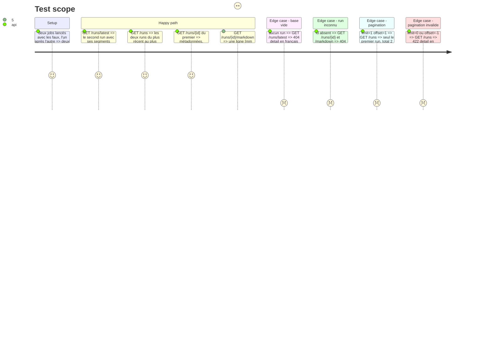

# Instruction: Lecture des runs, routes, vue Markdown, tests et mémoire

## Architecture projection

> Tree of the final files. ✅ create · ✏️ modify · ❌ delete

```txt
.
├── app/
│   ├── runs.py            ✏️ méthodes de lecture de RunStore et rendu Markdown
│   └── main.py            ✏️ routes GET /runs, /runs/latest, /runs/{id}, /runs/{id}/markdown
├── tests/
│   └── test_runs.py       ✏️ tests des routes de lecture
├── README.md              ✏️ section API
└── aidd_docs/memory/
    ├── api.md             ✏️ ressources /runs
    └── architecture.md    ✏️ le diagramme et la ligne sur la lecture des runs, si elle devient fausse
```

## User Journey



## Test Scope



## Tasks to do

### `1)` Lecture dans `RunStore`

> Lire les runs sans exposer de SQL aux routes.

1. `list_runs(limit, offset)` rend les résumés triés par `started_at DESC, rowid DESC`, plus `count()`.
2. `get_run(id)` rend toutes les colonnes, `settings`, `machine`, `versions` décodés en objets, et `segments` dans l'ordre de `position`, ou `None`.
3. `latest_id()` rend l'id du run le plus récent, ou `None`.
4. `to_markdown(run)` rend `# <titre ou video_id>`, une ligne vide, puis une ligne `[mm:ss] texte` par segment (`[h:mm:ss]` dès 3600 s).

### `2)` Routes

> Exposer la lecture en suivant les contrats de `api.md`.

1. `GET /runs` avec `limit`, `offset`, `422` en français si hors bornes ou non entiers.
2. `GET /runs/latest`, `404 {"detail": "Aucun run."}` sur base vide.
3. `GET /runs/{id}`, `404 {"detail": "Run inconnu."}`.
4. `GET /runs/{id}/markdown`, `text/markdown; charset=utf-8`, même `404`.

### `3)` Tests

> Couvrir les trois routes et la vue Markdown dans `tests/test_runs.py`, avec les faux de `tests/test_jobs.py`.

1. Deux runs, ordre de `/runs`, `/runs/latest` rend le second.
2. Détail complet et `404`.
3. Markdown, dont le format `[h:mm:ss]` sur un segment après une heure.
4. Pagination et `422`.

### `4)` Mémoire et README

> Garder vrai ce que le changement rend faux.

1. `aidd_docs/memory/api.md` : les ressources `/runs`.
2. `README.md` : section API.
3. `aidd_docs/memory/architecture.md`, `codebase-map.md`, `testing.md` : corriger seulement ce qui devient faux.

## Test acceptance criteria

| Task | Acceptance criteria |
| ---- | ------------------- |
| 1 | `RunStore` rend les runs du plus récent au plus ancien, le détail avec ses segments ordonnés, `None` pour un id inconnu |
| 2 | Après deux runs, `GET /runs/latest` rend le second et `GET /runs` les deux dans l'ordre. `GET /runs/{id}` rend métadonnées, télémétrie et segments, `404` pour un run inconnu |
| 2 | La vue Markdown d'un run rend une ligne `[mm:ss]` par segment |
| 3 | `scripts/check.sh` passe, couverture au-dessus de 80 % |
| 4 | `api.md` et le README décrivent les routes `/runs` |
