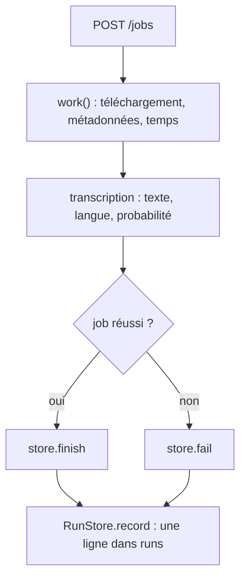
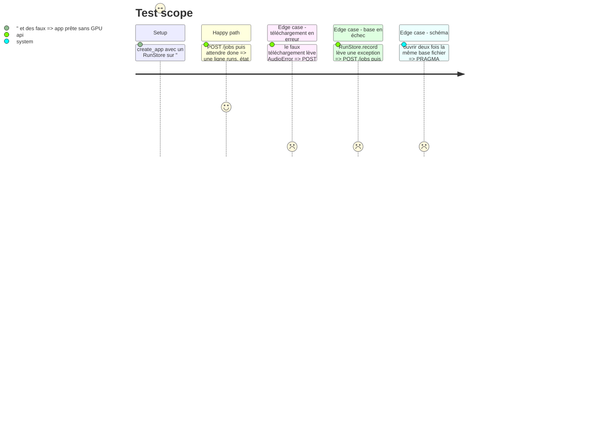

# Instruction: Collecter la télémétrie et écrire la table `runs`

## Architecture projection

> Tree of the final files. ✅ create · ✏️ modify · ❌ delete

```txt
.
├── app/
│   ├── runs.py        ✅ RunStore : schéma versionné par PRAGMA user_version, écriture d'une ligne par run
│   ├── machine.py     ✅ machine et versions, lues une fois : nvidia-smi, /proc, importlib.metadata
│   ├── audio.py       ✏️ download_audio rend le chemin et les métadonnées (titre, chaîne, durée)
│   ├── transcribe.py  ✏️ run rend texte, langue et probabilité ; settings() rend les réglages du modèle
│   ├── fake.py        ✏️ les faux suivent les nouveaux types de retour
│   └── main.py        ✏️ work() mesure les temps et écrit le run en fin de job ; create_app reçoit le RunStore
└── tests/
    ├── test_runs.py   ✅ écriture d'un run réussi et d'un run en erreur, sur une base en mémoire
    ├── test_jobs.py   ✏️ les faux suivent les nouveaux types de retour
    └── test_fake.py   ✏️ idem si le mode fake vérifie les retours
```

## User Journey



## Test Scope



## Tasks to do

### `1)` Métadonnées du téléchargement

> `download_audio` rend aussi ce que yt-dlp sait déjà de la vidéo.

1. Ajouter un dataclass `Download` (`path`, `title`, `channel`, `duration`) dans `app/audio.py`.
2. Le remplir depuis le dictionnaire de `extract_info`, champs absents à `None`.

### `2)` Résultat de la transcription

> `Transcriber.run` rend la langue détectée en plus du texte.

1. Ajouter un dataclass `Transcript` (`text`, `language`, `language_probability`) dans `app/transcribe.py`, remplis depuis `info`.
2. Sortir les réglages de `model.transcribe` en une source unique, et `settings()` rend modèle, `compute_type`, `beam_size`, `vad_filter`, `condition_on_previous_text`, `hotwords`.

### `3)` Machine et versions

> Un module qui lit la machine une fois, sans jamais lever.

1. `app/machine.py` : CPU (`/proc/cpuinfo`, nombre de cœurs), RAM (`/proc/meminfo`), GPU par `nvidia-smi --query-gpu=name,memory.total,driver_version` et CUDA depuis la sortie de `nvidia-smi`, OS (`platform.platform()` et `/etc/os-release`), Docker depuis `HOST_DOCKER_VERSION`.
2. Versions de faster-whisper, ctranslate2, av, yt-dlp par `importlib.metadata`.
3. Toute lecture qui échoue donne `None`, jamais une exception.

### `4)` RunStore

> Une base SQLite, une ligne par run, schéma versionné.

1. `app/runs.py` : `RunStore(path)`, une connexion `check_same_thread=False` protégée par un verrou, dossier parent créé si absent.
2. Schéma 1 : table `runs` avec les colonnes des familles Identité, Résultat et Temps, et trois colonnes JSONB écrites par `jsonb(?)` (réglages, machine, versions). `PRAGMA user_version = 1` posé à la création seulement.
3. `record(...)` insère la ligne en une transaction.

### `5)` Brancher dans le job

> `work()` mesure les temps et écrit le run, réussi ou en erreur.

1. `create_app(transcriber, download, runs=None)` : `None` donne un `RunStore(":memory:")`. `build_app` passe `RunStore(os.environ.get("YT_DB", "/data/runs.db"))`, y compris en `YT_FAKE=1`.
2. Lire la machine et les versions une fois dans le lifespan.
3. Dans `work()`, mesurer début (UTC), téléchargement, transcription et total avec `time.monotonic()`, puis écrire le run dans un `finally`. Une exception de `record` est écrite dans le log et n'est pas propagée.
4. Mettre à jour les faux de `app/fake.py`, `tests/test_jobs.py` et `tests/test_fake.py`.

### `6)` Tests

> pytest couvre l'écriture d'un run, sur une base en mémoire.

1. `tests/test_runs.py` : les quatre scénarios du Test Scope, lus par `json_extract` pour les colonnes JSONB.
2. `scripts/check.sh` passe, couverture au-dessus de 80 %.

## Test acceptance criteria

| Task | Acceptance criteria                                                                                                  |
| ---- | -------------------------------------------------------------------------------------------------------------------- |
| 1    | un téléchargement rend le chemin du fichier et le titre, la chaîne et la durée de la vidéo, ou `None` pour chacun    |
| 2    | une transcription rend le texte, la langue détectée et sa probabilité, et les réglages sont lisibles sans transcrire |
| 3    | sans GPU ni `nvidia-smi`, la lecture de la machine rend des champs `None` sans lever                                  |
| 4    | une base neuve porte `user_version` 1 et une table `runs` vide, une base déjà créée n'est pas modifiée à l'ouverture |
| 5    | après un job réussi puis un job en erreur, la table `runs` compte deux lignes, avec leur état final                  |
| 5    | une base qui refuse l'écriture laisse le job `done` avec son texte                                                    |
| 6    | `scripts/check.sh` termine sans erreur                                                                               |
