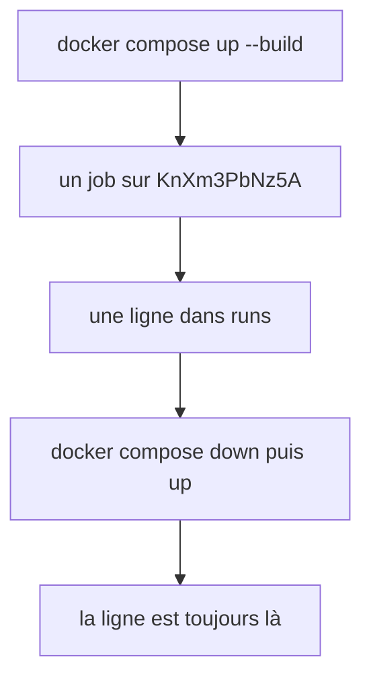
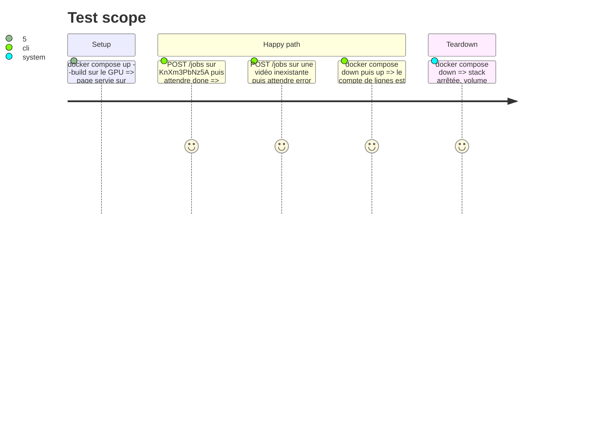

# Instruction: Volume Compose, persistance vérifiée et mémoire à jour

## Architecture projection

> Tree of the final files. ✅ create · ✏️ modify · ❌ delete

```txt
.
├── compose.yaml                       ✏️ volume nommé runs-data monté sur /data, HOST_DOCKER_VERSION transmis
├── README.md                          ✏️ section sur l'historique des runs, comment passer la version de Docker
└── aidd_docs/memory/
    ├── architecture.md                ✏️ runs terminés en SQLite, job en cours en mémoire
    ├── deployment.md                  ✏️ second volume et variables YT_DB, HOST_DOCKER_VERSION
    ├── codebase-map.md                ✏️ app/runs.py et app/machine.py
    └── testing.md                     ✏️ tests/test_runs.py, base en mémoire
```

## User Journey



## Test Scope



## Tasks to do

### `1)` Volume et variables

> La base vit sur un volume nommé qui survit au conteneur.

1. Ajouter le volume `runs-data` monté sur `/data` dans `compose.yaml`.
2. Transmettre `HOST_DOCKER_VERSION: ${HOST_DOCKER_VERSION:-}`.

### `2)` Persistance vérifiée

> Un run réel survit à un redémarrage de la stack.

1. Lancer la stack, un job réussi et un job en erreur, compter les lignes de `runs` avec le module `sqlite3` de Python dans le conteneur.
2. `docker compose down` puis `up`, recompter.
3. Vérifier que `scripts/e2e.sh fake` passe toujours.

### `3)` Mémoire et README

> Ce que le changement rend faux est corrigé.

1. `architecture.md` : la ligne « Jobs live in memory only » devient vraie pour le job en cours seulement, et pointe vers `run-storage.md`.
2. `deployment.md` : volume `runs-data`, `YT_DB`, `HOST_DOCKER_VERSION`. « `HOTWORDS` is the only setting » devient faux.
3. `codebase-map.md` et `testing.md` : les nouveaux modules et le nouveau fichier de test.
4. README : où vit l'historique, comment le lire, comment passer la version de Docker.

## Test acceptance criteria

| Task | Acceptance criteria                                                                                       |
| ---- | --------------------------------------------------------------------------------------------------------- |
| 1    | `docker volume ls` montre le volume des runs après `docker compose up`                                    |
| 2    | après un job réussi et un job en erreur sur la vraie stack, `runs` gagne deux lignes                      |
| 2    | après `docker compose down` puis `up`, le nombre de lignes de `runs` est inchangé                          |
| 2    | `scripts/e2e.sh fake` passe                                                                               |
| 3    | aucune ligne de `aidd_docs/memory/` ni du README ne dit encore que les runs sont perdus au redémarrage     |
