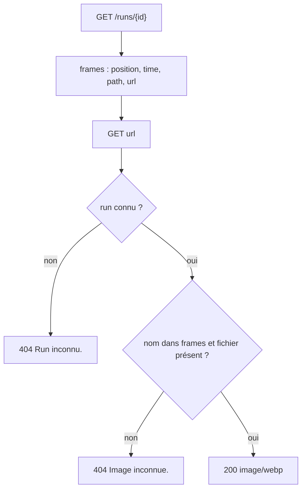
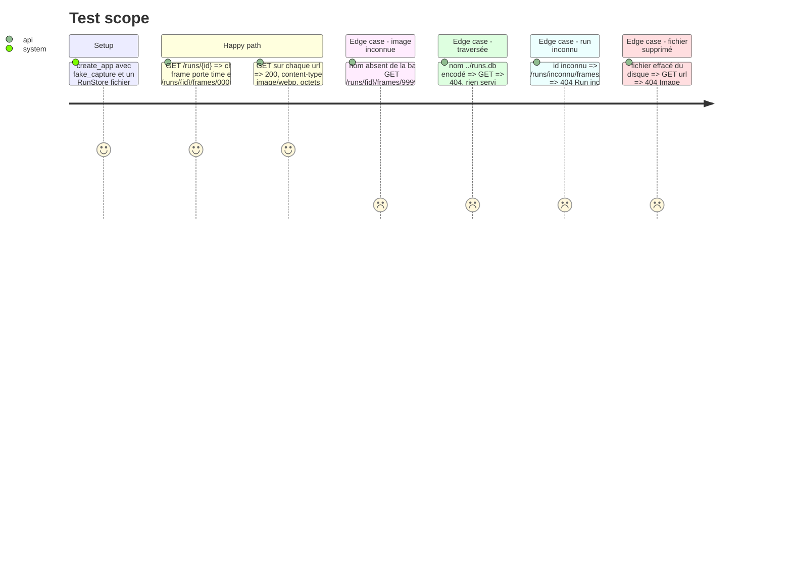

# Instruction: Route des images, champ `url`, tests et mémoire

## Architecture projection

> Tree of the final files. ✅ create · ✏️ modify · ❌ delete

```txt
.
├── app/
│   ├── main.py   ✏️ route GET /runs/{run_id}/frames/{name}, url ajoutée aux frames de get_run et get_latest_run
│   └── runs.py   ✏️ RunStore.frame_file(run_id, name) -> Path | None
├── tests/
│   ├── test_jobs.py  ✏️ ou test_runs.py : run illustré, url listée, curl de l'url, 404
├── README.md         ✏️ section API, ligne 38 sur #52
└── aidd_docs/memory/
    ├── api.md        ✏️ nouvelle route, champ url, retrait de « no route serves the files before #52 »
    └── codebase-map.md ✏️ seulement si la description de runs.py devient fausse
```

## User Journey



## Test Scope



## Tasks to do

### `1)` Retrouver le fichier d'une image

> Le stockage dit où est le fichier, et seulement s'il est connu.

1. `RunStore.frame_file(run_id: str, name: str) -> Path | None` : `None` si `self._root` vaut `None`. Sinon, lire les `path` des lignes `frames` du run et garder celui dont `Path(path).name == name`. Rendre `self._root / path` s'il existe sur le disque, `None` sinon.

### `2)` Route des images

> Un agent télécharge une image par son URL.

1. `GET /runs/{run_id}/frames/{name}` dans `create_app`. Si le run est inconnu (`runs.get_run` ou une requête plus légère), répondre `404 {"detail": "Run inconnu."}`.
2. Sinon, si `runs.frame_file` rend `None`, répondre `404 {"detail": "Image inconnue."}`.
3. Sinon, `FileResponse(path, media_type="image/webp")`.

### `3)` URL de chaque image

> Le résultat d'un run liste chaque image avec son horodatage et son URL.

1. Dans `app/main.py`, un helper ajoute `url = f"/runs/{run['id']}/frames/{Path(f['path']).name}"` à chaque frame. `get_run` et `get_latest_run` l'appliquent.

### `4)` Tests

> Chaque critère de l'issue est prouvé par pytest.

1. Un run illustré avec `fake_capture` et une base dans `tmp_path` : chaque frame a `time` et `url`, et un `GET` de l'url rend `200`, `image/webp` et les octets du fichier.
2. Les cas en `404` : image inconnue, nom de traversée (`..%2Fruns.db`), run inconnu, fichier effacé, base `:memory:`.
3. `/runs/latest` porte aussi `url`.

### `5)` Mémoire et README

> Rien de ce qui est écrit ne devient faux.

1. `api.md` : ajouter la route, ajouter `url` dans la forme des frames, retirer « no route serves the files before #52 ».
2. `README.md` : la section API, et la ligne 38 qui annonce la route pour #52.
3. `codebase-map.md` : ne le corriger que si une phrase devient fausse.

## Test acceptance criteria

| Task | Acceptance criteria |
| ---- | ------------------- |
| 1 | `frame_file` ne rend un chemin que pour un nom listé dans la base et présent sur le disque |
| 2 | `curl /runs/{id}/frames/0000.webp` rend l'image, et `404` en français pour une image ou un run inconnus |
| 3 | `GET /runs/{id}` et `/runs/latest` listent chaque image avec `time` et `url` |
| 4 | `scripts/check.sh` passe, couverture au-dessus de 80 % |
| 5 | aucune ligne du README ni de la mémoire n'annonce encore la route « à venir avec #52 » |
