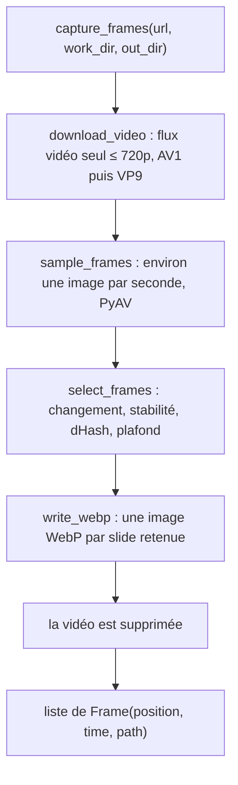
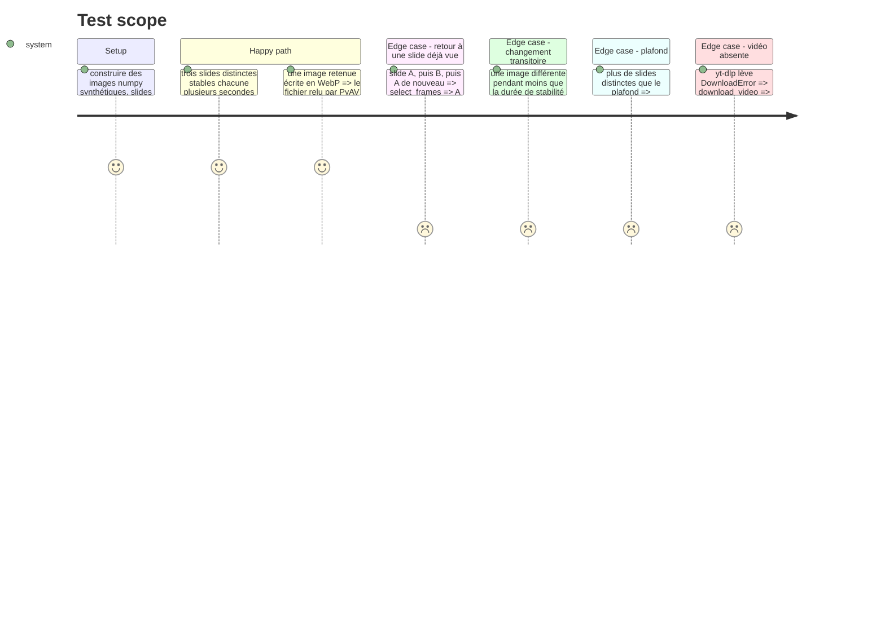

# Instruction: Module de capture : téléchargement, détection, dédoublonnage

## Architecture projection

> Tree of the final files. ✅ create · ✏️ modify · ❌ delete

```txt
.
├── pyproject.toml     ✏️ numpy en dépendance directe (uv.lock suit, même version 2.5.3)
├── uv.lock            ✏️ régénéré par uv lock, sans changement de version attendu
├── app/
│   └── frames.py      ✅ download_video, sample_frames, select_frames, dhash, write_webp, capture_frames, entrée `python -m app.frames`
└── tests/
    └── test_frames.py ✅ détection, stabilité, dédoublonnage, plafond et écriture WebP sur images numpy synthétiques
```

## User Journey



## Test Scope



## Tasks to do

### `1)` Déclarer numpy

> Le code importe numpy, il le déclare.

1. Ajouter `numpy` aux `dependencies` de `pyproject.toml`, puis `uv lock`. Vérifier que la version verrouillée reste 2.5.3.

### `2)` Télécharger le flux vidéo seul

> Un fichier vidéo sans audio, 720p au plus, AV1 préféré, sans fusion de flux.

1. `download_video(url, dest_dir) -> Path` dans `app/frames.py`, avec yt-dlp : format `bestvideo[height<=720][vcodec^=av01]/bestvideo[height<=720][vcodec^=vp09]/bestvideo[height<=720]`, `noplaylist`, silencieux, comme `download_audio`.
2. Réutiliser `AudioError` et la mise en forme de `app/audio.py` pour l'erreur, message « Impossible de télécharger la vidéo : … ». Factoriser `_readable` avec un préfixe plutôt que dupliquer.

### `3)` Échantillonner et sélectionner

> Une image par changement d'écran stable, sans doublon, dans la limite du plafond.

1. Constantes nommées : `SAMPLE_EVERY_S = 1.0`, `THUMB = (64, 36)` niveaux de gris, `CHANGE_THRESHOLD`, `STABLE_S = 3.0`, `HASH_DISTANCE = 6` (bits sur 64), `MAX_FRAMES = 80`. Commentaire : valeurs provisoires, calibrées par #53.
2. `sample_frames(video) -> Iterator[(time_s, rgb ndarray)]` : décode avec PyAV, garde une image par `SAMPLE_EVERY_S` à partir de `frame.time`.
3. `select_frames(samples) -> list[(time_s, rgb)]` : vignette grise par image, différence absolue moyenne avec la dernière candidate. Une candidate n'est retenue qu'une fois restée stable `STABLE_S`. Elle garde l'horodatage de son début.
4. `dhash(gray) -> int` sur 64 bits, et rejet d'une candidate dont la distance de Hamming à une image déjà gardée est ≤ `HASH_DISTANCE`. Arrêt au plafond.
5. `select_frames` est pure, testable sans PyAV ni réseau.

### `4)` Écrire et assembler

> La capture rend des fichiers WebP et ne laisse pas la vidéo.

1. `write_webp(rgb, path)` via PyAV, codec `libwebp`, une image.
2. `@dataclass Frame(position, time, path)` et `capture_frames(url, work_dir, out_dir) -> list[Frame]` : télécharge dans `work_dir`, sélectionne, écrit `out_dir/<position:04d>.webp`, supprime la vidéo dans un `finally`.
3. `if __name__ == "__main__"` : `python -m app.frames <url> [out_dir]` affiche une ligne `time path` par image, puis le nombre d'images et la vérification que `work_dir` ne contient plus de vidéo.

### `5)` Tests

> Le comportement de sélection est figé sur des images synthétiques.

1. `tests/test_frames.py` : un test par cas du Test Scope, avec des tableaux numpy construits dans le test, sans réseau. `download_video` testé en monkeypatchant `YoutubeDL` pour lever `DownloadError`.
2. Un test d'aller-retour `write_webp` puis décodage PyAV.

## Test acceptance criteria

| Task | Acceptance criteria                                                                                      |
| ---- | -------------------------------------------------------------------------------------------------------- |
| 1    | `numpy` figure dans les dépendances directes, la version verrouillée est inchangée                        |
| 2    | une vidéo indisponible donne une `AudioError` au message français lisible, sans trace                      |
| 3    | trois slides stables donnent trois images, un retour à une slide vue n'en ajoute pas, un flash n'en ajoute pas |
| 3    | le nombre d'images retenues ne dépasse jamais `MAX_FRAMES`                                                 |
| 4    | après `capture_frames`, `work_dir` ne contient plus le fichier vidéo, même si la sélection lève            |
| 5    | `scripts/check.sh` passe, couverture ≥ 80 %                                                               |
