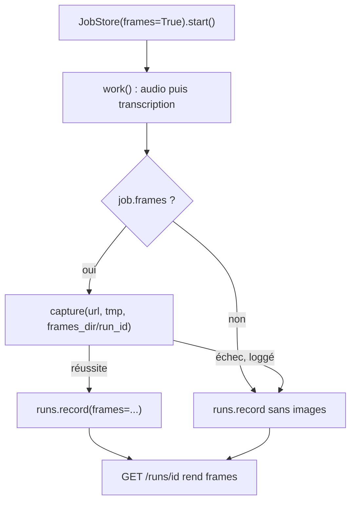
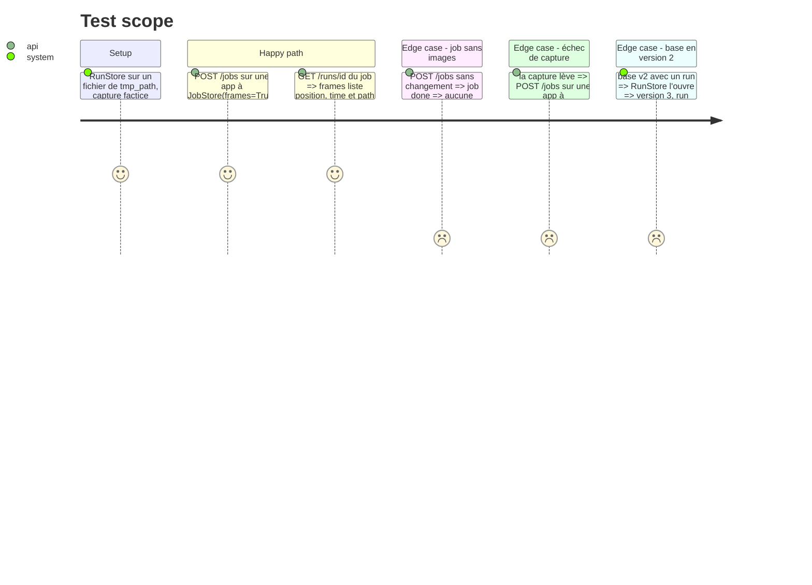

# Instruction: Brancher la capture dans le job et la table `frames`

## Architecture projection

> Tree of the final files. ✅ create · ✏️ modify · ❌ delete

```txt
.
├── app/
│   ├── runs.py        ✏️ schéma v3 : table frames, record(frames=...), get_run rend frames, frames_dir dérivé du chemin de la base
│   ├── jobs.py        ✏️ Job.frames ; JobStore(frames=False) l'applique à chaque job qu'il démarre
│   ├── fake.py        ✏️ fake_capture : quelques WebP synthétiques, sans réseau
│   └── main.py        ✏️ create_app(capture=capture_frames, jobs=None) ; work() capture après la transcription si job.frames
└── tests/
    ├── test_runs.py   ✏️ migration v2 vers v3, version attendue 3, frames écrites et relues, run sans images
    └── test_jobs.py   ✏️ un job avec images écrit ses lignes frames, un échec de capture laisse le job done
```

## User Journey



## Test Scope



## Tasks to do

### `1)` Table `frames`

> Une ligne par image, rattachée au run, dans la même transaction que le run.

1. `_FRAMES_SCHEMA` : `run_id TEXT NOT NULL REFERENCES runs(id)`, `position INTEGER NOT NULL`, `time REAL NOT NULL`, `path TEXT NOT NULL`, clé `(run_id, position)`. `SCHEMA_VERSION = 3`, étape `if version < 3` dans `_migrate`.
2. `record(..., frames: Sequence[Frame] = ())` insère les lignes dans la même transaction que `runs` et `segments`.
3. `get_run` ajoute `frames: [{position, time, path}]` triés par `position`.
4. `RunStore.frames_dir` : `Path(path).parent / "frames"` pour un fichier, `None` pour `:memory:`. Les chemins en table sont relatifs au dossier de la base (`frames/<run_id>/0000.webp`).

### `2)` Drapeau de job

> Le job sait s'il capture les images, `POST /jobs` ne change pas.

1. `Job.frames: bool = False`, `JobStore(frames: bool = False)` qui le recopie dans chaque job démarré. `view()` inchangée.
2. `create_app(..., jobs: JobStore | None = None)` pour que les tests injectent `JobStore(frames=True)`. #51 remplacera ce défaut par un choix par job.

### `3)` Capture dans le worker

> Les images sont capturées après la transcription, et leur échec ne coûte pas le texte.

1. `create_app(..., capture=capture_frames)`. Dans `work()`, si `job.frames` et `runs.frames_dir` : après la transcription réussie, `capture(url, Path(tmp), runs.frames_dir / job.id)` dans le même `TemporaryDirectory`.
2. Échec de capture : `log.exception("Could not capture frames for run %s", job.id)`, supprimer le dossier d'images partiel, job `done` sans images.
3. `build_app` en mode `YT_FAKE=1` passe `fake_capture`.

### `4)` Faux et tests

> Le chemin complet tourne sans réseau ni GPU.

1. `fake_capture(url, work_dir, out_dir)` dans `app/fake.py` : écrit deux WebP synthétiques via `write_webp`, rend deux `Frame`.
2. Tests du Test Scope dans `tests/test_runs.py` et `tests/test_jobs.py`. Le job avec images passe par le vrai `POST /jobs` d'une app créée avec `jobs=JobStore(frames=True)`, sans champ d'API ajouté. Mettre à jour les assertions `user_version == 2` en `3`.

## Test acceptance criteria

| Task | Acceptance criteria                                                                                   |
| ---- | ----------------------------------------------------------------------------------------------------- |
| 1    | une base v2 existante passe en v3 sans perdre ses runs ni ses segments                                 |
| 1    | `GET /runs/{id}` rend `frames`, vide pour un run sans images                                           |
| 2    | `POST /jobs` rend le même corps et le même comportement qu'avant, sans capture                          |
| 3    | un job avec images écrit une ligne `frames` par fichier WebP présent sur le disque                       |
| 3    | une capture qui lève laisse le job `done` avec son texte et aucune ligne `frames`                        |
| 4    | `scripts/check.sh` passe, couverture ≥ 80 %                                                            |
