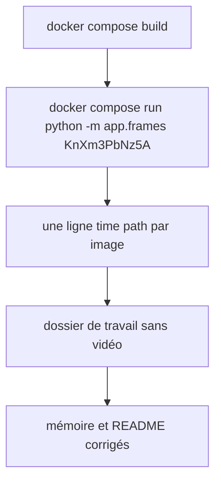
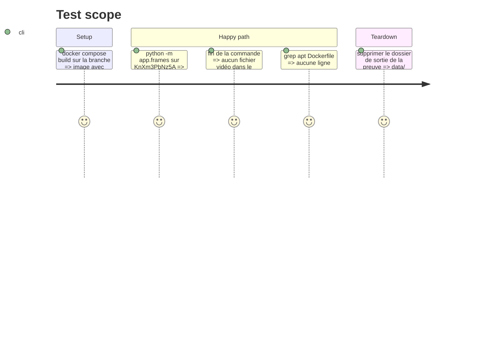

# Instruction: Preuve sur `KnXm3PbNz5A` et mémoire à jour

## Architecture projection

> Tree of the final files. ✅ create · ✏️ modify · ❌ delete

```txt
.
├── README.md                                   ✏️ capture des images : où elles vont, comment la lancer à la main, ce qui reste à #51 et #52
└── aidd_docs/memory/
    ├── architecture.md                         ✏️ flux vidéo seul, capture après transcription, table frames, schéma v3
    ├── integration.md                          ✏️ YouTube : audio seul et, avec images, vidéo seule ≤ 720p
    ├── api.md                                  ✏️ GET /runs/{id} rend frames
    ├── codebase-map.md                         ✏️ app/frames.py
    ├── deployment.md                           ✏️ data/frames/<run_id>/ à côté de runs.db
    └── testing.md                              ✏️ tests/test_frames.py, fake_capture
```

## User Journey



## Test Scope



## Tasks to do

### `1)` Preuve réelle

> Le premier critère de #50 tient sur la vraie vidéo, dans la vraie image.

1. `docker compose build`, puis `docker compose run --rm --no-deps yt-transcriber python -m app.frames https://www.youtube.com/watch?v=KnXm3PbNz5A /tmp/frames-proof`.
2. Relever : nombre d'images, premier et dernier horodatage, codec téléchargé, temps total, absence de la vidéo. Les consigner dans le commentaire de PR, pas dans l'ADR (le calibrage est #53).
3. Vérifier `grep -n apt Dockerfile` vide.

### `2)` Mémoire et README

> Rien de ce que le repo affirme n'est rendu faux par la capture.

1. Corriger les six fichiers de mémoire de la projection et le README, en français pour le contenu.
2. Ne pas toucher l'ADR `frames-pyav.md` sauf si une mesure contredit une affirmation, auquel cas ajouter la mesure.

## Test acceptance criteria

| Task | Acceptance criteria                                                                                  |
| ---- | ---------------------------------------------------------------------------------------------------- |
| 1    | sur `KnXm3PbNz5A`, la commande rend au moins une image horodatée et aucune vidéo ne reste sur le disque |
| 1    | le `Dockerfile` ne contient aucun `apt`                                                               |
| 2    | `architecture.md` et `integration.md` décrivent la capture vidéo, aucune ligne de mémoire ne dit « audio seulement » sans nuance |
