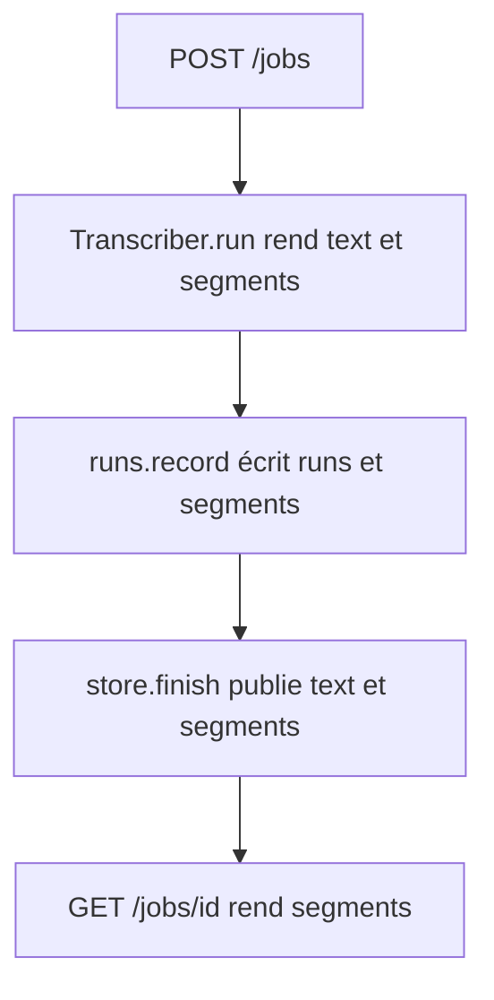
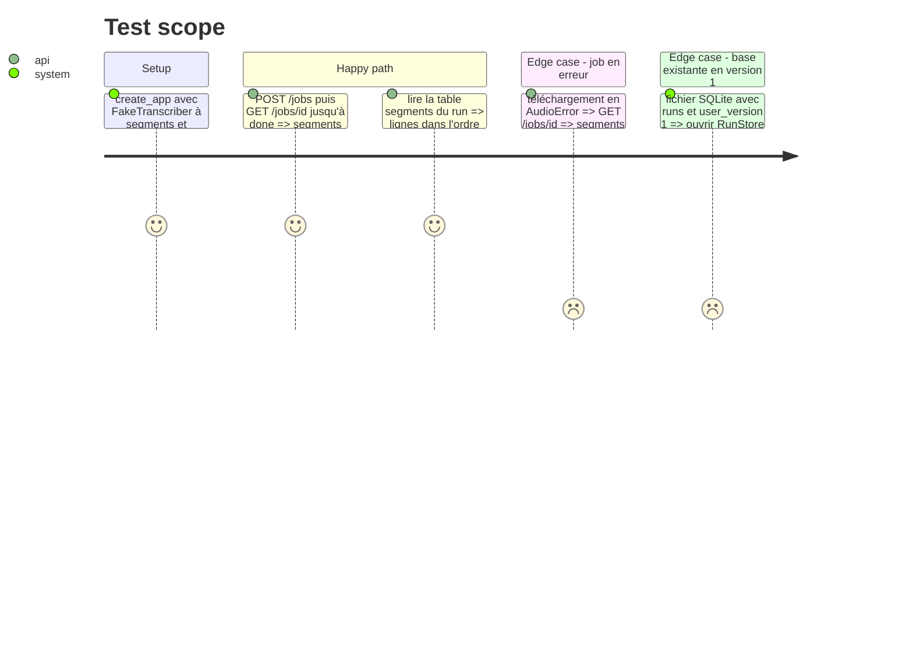

# Instruction: Segments dans le transcripteur, le job, l'API et la base

## Architecture projection

> Tree of the final files. ✅ create · ✏️ modify · ❌ delete

```txt
.
├── app/
│   ├── transcribe.py   ✏️ dataclass Segment, Transcript.segments, run() garde les segments
│   ├── fake.py         ✏️ FakeTranscriber rend des segments dont la jonction donne FAKE_TEXT
│   ├── jobs.py         ✏️ Job.segments, view() les expose, finish() les reçoit
│   ├── runs.py         ✏️ schéma v2, table segments, migration depuis v1, record(segments=...)
│   └── main.py         ✏️ work() passe les segments à runs.record et à store.finish
└── tests/
    ├── test_jobs.py    ✏️ FakeTranscriber local rend des segments, test de l'API
    ├── test_fake.py    ✏️ segments factices cohérents avec FAKE_TEXT
    └── test_runs.py    ✏️ segments en base dans l'ordre, migration d'une base v1
```

## User Journey



## Test Scope



## Tasks to do

### `1)` Le transcripteur rend les segments

> `Transcript` porte la liste des segments que `run()` lit déjà.

1. Ajouter `@dataclass Segment(start: float, end: float, text: str)` dans `app/transcribe.py`.
2. Ajouter `segments: list[Segment] = field(default_factory=list)` à `Transcript`.
3. Dans `run()`, garder chaque segment au texte non vide, strippé, et construire `text` par la même jonction qu'aujourd'hui.
4. `FakeTranscriber` (`app/fake.py`) rend trois segments, un par phrase de `FAKE_TEXT`, répartis sur `FAKE_DURATION`, dont `" ".join` redonne `FAKE_TEXT`.

### `2)` Le job expose les segments

> `GET /jobs/{id}` rend `segments`, `[]` tant que le job n'est pas `done`.

1. `Job.segments: list[Segment]`, vide par défaut.
2. `JobStore.finish(job, text, segments)` les enregistre sous le verrou.
3. `Job.view()` ajoute `"segments": [{"start", "end", "text"}]`.
4. `work()` dans `app/main.py` passe `result.segments` à `store.finish`.

### `3)` La base garde les segments

> Chaque run `done` écrit ses segments dans la table `segments`, dans l'ordre, une base v1 migre sans perte.

1. `SCHEMA_VERSION = 2`, table `segments (run_id TEXT NOT NULL REFERENCES runs(id), position INTEGER NOT NULL, start REAL NOT NULL, end REAL NOT NULL, text TEXT NOT NULL, PRIMARY KEY (run_id, position))`.
2. Migration incrémentale à l'ouverture : `user_version < 1` crée `runs`, `< 2` crée `segments`, puis `user_version = 2`, dans une transaction.
3. `record(..., segments=())` insère le run puis ses segments dans la même transaction, `position` suivant l'ordre de la liste.
4. `work()` passe `result.segments` quand le run est `done`, rien sinon.

### `4)` Tests

> Les comportements ci-dessous sont couverts par pytest, sans GPU.

1. `tests/test_jobs.py` : le `FakeTranscriber` local rend des segments, un test vérifie `segments` dans `GET /jobs/{id}` et `text` inchangé.
2. `tests/test_fake.py` : la jonction des segments factices vaut `FAKE_TEXT`, les bornes sont croissantes et finissent à `FAKE_DURATION`.
3. `tests/test_runs.py` : segments en base dans l'ordre pour un run `done`, aucun pour un run en erreur, migration d'un fichier v1 créé à la main dans `tmp_path`.
4. `scripts/check.sh` passe, seuil de couverture compris.

## Test acceptance criteria

| Task | Acceptance criteria                                                                                                  |
| ---- | -------------------------------------------------------------------------------------------------------------------- |
| 1    | `Transcriber.run` et `FakeTranscriber.run` rendent des segments dont la jonction est le `text` rendu                  |
| 2    | `GET /jobs/{id}` d'un job `done` rend `segments`, liste de `{start, end, text}` en secondes, et `text` est inchangé   |
| 3    | Les segments d'un run `done` sont dans la table `segments`, triés par `position` dans l'ordre de la transcription      |
| 3    | Une base en version 1 avec des runs s'ouvre, gagne la table `segments`, passe en version 2 et garde ses runs          |
| 4    | `scripts/check.sh` sort en 0                                                                                          |
