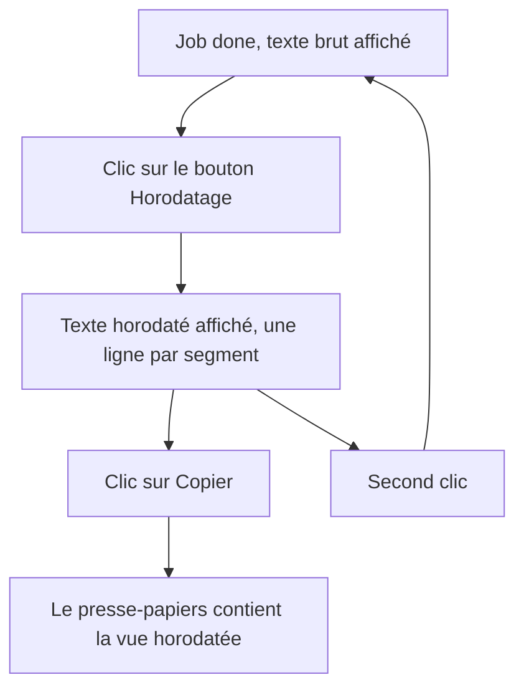
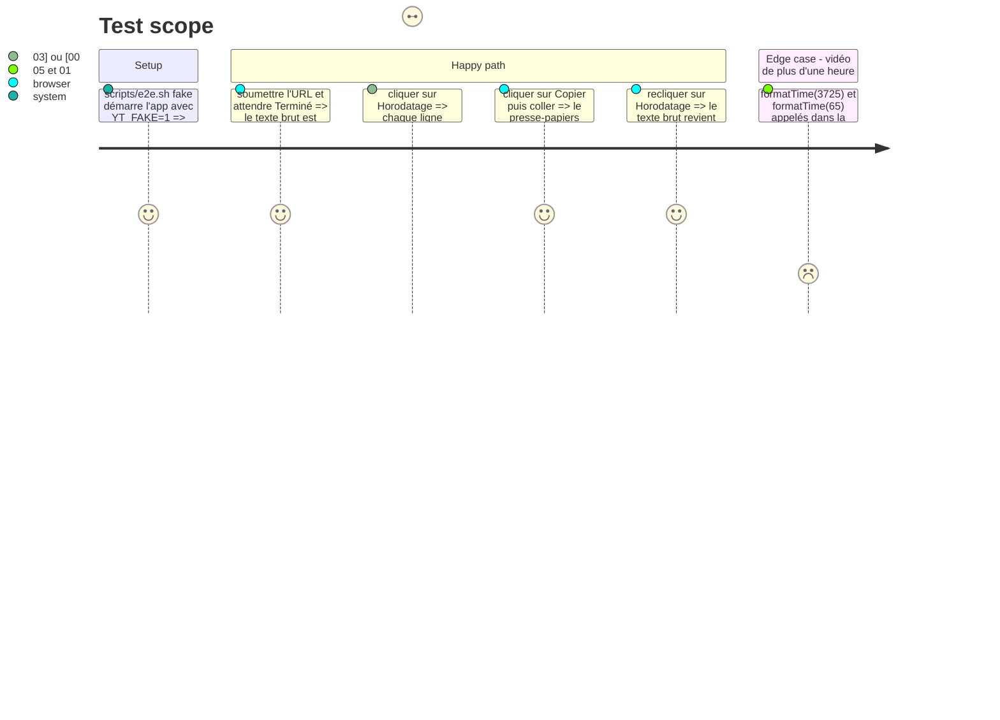

# Instruction: Bascule de la page, scénario Playwright et mémoire à jour

## Architecture projection

> Tree of the final files. ✅ create · ✏️ modify · ❌ delete

```txt
.
├── app/static/
│   ├── index.html      ✏️ bouton de bascule #timestamps à côté de #copy
│   └── app.js          ✏️ formatTime, vue horodatée, bascule, la copie suit la vue
├── e2e/
│   └── test_page.py    ✏️ scénario de bascule et de format d'heure
├── README.md           ✏️ ligne 3 « sans horodatage », section API, nombre de contrôles e2e
└── aidd_docs/memory/
    ├── api.md            ✏️ champ segments de GET /jobs/{id}
    ├── project-brief.md  ✏️ « no timestamps », features
    ├── architecture.md   ✏️ la table segments à côté de runs
    ├── design.md         ✏️ accessibilité du bouton de bascule
    └── testing.md        ✏️ sept scénarios e2e
```

## User Journey



## Test Scope



## Wireframe

```txt
┌──────────────────────────────────────────────────────────┐
│ [1] yt-transcriber                              [thème]   │
│ [2] [ URL ................................ ] [Transcrire] │
│ [3] statut / erreur                                       │
│ ┌──────────────────────────────────────────────────────┐ │
│ │ [4] transcription                     [5][⏱] [6][⧉] │ │
│ │                                                      │ │
│ └──────────────────────────────────────────────────────┘ │
└──────────────────────────────────────────────────────────┘
```

1. En-tête et bouton de thème, inchangés.
2. Formulaire, inchangé.
3. Lignes de statut et d'erreur, inchangées.
4. Zone de texte, montre la vue choisie.
5. Nouveau bouton icône de bascule horodatage, à gauche de la copie.
6. Bouton de copie, copie la vue affichée.

## Tasks to do

### `1)` Bascule dans la page

> Un bouton bascule la zone de texte entre `text` et la vue horodatée.

1. `index.html` : bouton `#timestamps`, icône horloge, `aria-label="Afficher l'horodatage"` stable, `aria-pressed="false"`, mêmes classes que `#copy`, placé à sa gauche, `pr-` de la zone de texte élargi pour deux boutons.
2. `app.js` : `formatTime(seconds)` rend `mm:ss`, ou `h:mm:ss` dès une heure. `timedText(segments)` rend une ligne `[t] texte` par segment.
3. `app.js` : garder le dernier job `done` dans une variable, `render()` écrit `text` ou la vue horodatée dans `#out` selon `aria-pressed`. Un nouveau job vide la variable.
4. La copie lit déjà `#out.value`, donc elle suit la vue sans changement. Le vérifier.

### `2)` Scénario Playwright

> `scripts/e2e.sh fake` couvre la bascule et la copie de la vue horodatée.

1. Ajouter `test_timestamps_toggle_switches_the_view_and_the_copy` dans `e2e/test_page.py`, qui tient aux deux niveaux (motif `^\[\d{2}:\d{2}\] ` par ligne, sans valeurs propres au faux).
2. Vérifier `formatTime` par `page.evaluate` pour `65` et `3725`.
3. Lancer `scripts/e2e.sh fake`.

### `3)` Mémoire et README

> Plus aucune ligne ne dit « sans horodatage », l'API documente `segments`.

1. `README.md` : ligne 3, section API (`segments`), « Cinq contrôles » remplacé par la liste à jour des sept.
2. `aidd_docs/memory/api.md` : `GET /jobs/{id}` rend aussi `segments`.
3. `aidd_docs/memory/project-brief.md` : retirer « no timestamps », ajouter la vue horodatée aux features.
4. `aidd_docs/memory/architecture.md` : la table `segments` à côté de `runs`.
5. `aidd_docs/memory/design.md` : `aria-label` et `aria-pressed` du bouton de bascule.
6. `aidd_docs/memory/testing.md` : sept scénarios e2e.

## Test acceptance criteria

| Task | Acceptance criteria                                                                                                  |
| ---- | -------------------------------------------------------------------------------------------------------------------- |
| 1    | Après un job `done`, un clic sur le bouton affiche une ligne `[mm:ss] texte` par segment, un second clic le texte brut |
| 1    | Le bouton Copier met dans le presse-papiers exactement la vue affichée                                                 |
| 1    | Un début de segment au-delà d'une heure s'affiche `[h:mm:ss]`                                                          |
| 2    | `scripts/e2e.sh fake` sort en 0 avec le nouveau scénario                                                               |
| 3    | `grep -ri "no timestamps\|sans horodatage" README.md aidd_docs/memory` ne rend rien, et `segments` figure dans `api.md` et le README |
