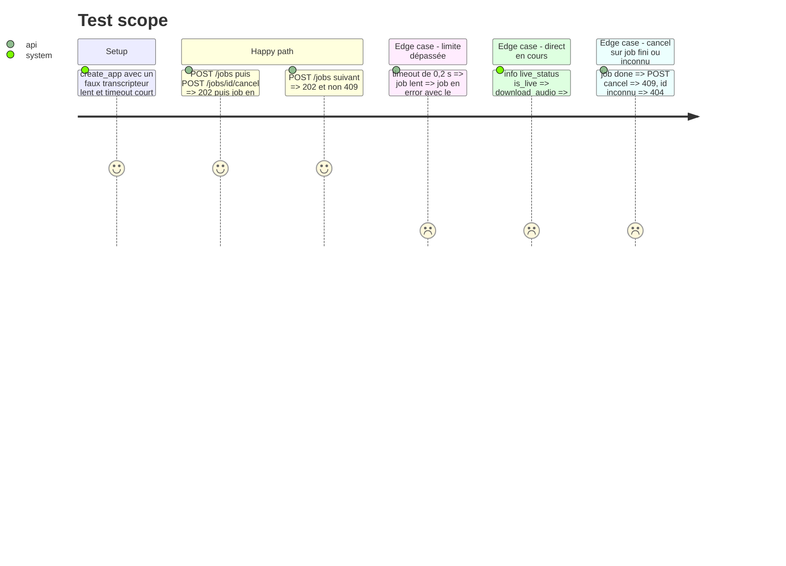

# Instruction: Limite, annulation et refus des directs côté API

## Architecture projection

> Tree of the final files. ✅ create · ✏️ modify · ❌ delete

```txt
.
├── app/
│   ├── jobs.py        ✏️ JOB_TIMEOUT_S, JobStopped, drapeau d'annulation et échéance du Job, JobStore.cancel
│   ├── main.py        ✏️ create_app(timeout=...), check passé aux étapes, route POST /jobs/{job_id}/cancel
│   ├── audio.py       ✏️ refus des directs en cours, hook de progression qui appelle check
│   ├── transcribe.py  ✏️ on_progress appelé à chaque segment, même sans durée connue
│   ├── frames.py      ✏️ check dans le hook de download_video et dans la boucle sample_frames
│   ├── fake.py        ✏️ les faux honorent check (annulation possible en YT_FAKE=1)
│   └── contract.py    ✏️ rien de neuf si JobCreated et Detail suffisent, sinon le modèle de la route
└── tests/
    ├── test_jobs.py     ✏️ limite, annulation, 404 et 409 de la route cancel
    ├── test_audio.py    ✅ refus d'un direct, avec un faux YoutubeDL
    ├── test_contract.py ✏️ EXPECTED gagne la route cancel
    ├── test_fake.py     ✏️ les faux s'arrêtent sur check
    └── test_frames.py   ✏️ sample_frames s'arrête sur check si c'est testable sans décodage
```

## Test Scope



## Tasks to do

### `1)` État d'arrêt du job

> Un job sait s'il doit s'arrêter, et pourquoi.

1. `app/jobs.py` : `JOB_TIMEOUT_S = 900`, exception `JobStopped(message)`, champs `cancel` (`threading.Event`) et `deadline` (monotonic) sur `Job`.
2. `Job.check()` lève `JobStopped("Transcription annulée.")` ou `JobStopped` avec un message français qui cite la limite en minutes.
3. `JobStore.cancel(job_id)` : `None` si inconnu, `False` si fini, sinon pose le drapeau et rend `True`.

### `2)` Points de passage

> Chaque étape longue appelle `check` assez souvent pour s'arrêter en quelques secondes.

1. `app/audio.py` et `app/frames.py` : paramètre optionnel `check` (défaut no-op), `progress_hooks: [lambda _: check()]`. Vérifier empiriquement qu'une exception levée dans le hook sort de `extract_info` (sinon lever depuis le hook une `DownloadCancelled` et la traduire).
2. `app/transcribe.py` : `on_progress` appelé à chaque segment, avec la dernière progression connue quand `info.duration` est vide.
3. `app/frames.py` : `capture_frames(..., check=...)` appelle `check` dans la boucle d'échantillonnage.
4. `app/main.py`, `work` : `job.check()` entre les étapes, passé au téléchargement, au callback de progression et à la capture. `except JobStopped` met le message du job et un run `error`. Une capture arrêtée par `JobStopped` termine le job en `error`, pas en `done` sans images.
5. `app/fake.py` : les faux appellent `check` à chaque pas.

### `3)` Refus des directs

> Un direct en cours est refusé avant tout téléchargement.

1. `download_audio` : `extract_info(url, download=False)`, puis `AudioError("Les directs en cours ne sont pas pris en charge : attends la fin du direct.")` si `live_status` vaut `is_live` ou `is_upcoming`, sinon `process_ie_result(info, download=True)`.
2. Garder `title`, `channel`, `duration` et le chemin comme avant.

### `4)` Route d'annulation

> L'appelant peut demander l'arrêt du job en cours.

1. `POST /jobs/{job_id}/cancel` : `202 {"id"}`, `404 {"detail": "Job inconnu."}`, `409 {"detail": "Ce job est déjà terminé."}`.
2. `app/contract.py` et `EXPECTED` de `tests/test_contract.py` dans le même changement.

### `5)` Tests

> Les critères de l'issue sont couverts par pytest.

1. Limite : `create_app(..., timeout=0.2)` avec un faux lent, job `error`, run `error`, `POST /jobs` suivant `202`.
2. Annulation : pendant le téléchargement et pendant la transcription, job `error`, `POST /jobs` suivant `202`.
3. Route cancel : `404` et `409`, corps validés contre le contrat.
4. Direct : faux `YoutubeDL` monkeypatché, `AudioError` sans appel au téléchargement.
5. `scripts/check.sh` vert, seuil de couverture tenu.

## Test acceptance criteria

| Task | Acceptance criteria |
| ---- | ------------------- |
| 1 | un job annulé ou hors délai lève `JobStopped` à son prochain `check` |
| 2 | une annulation pendant le téléchargement ou la transcription termine le job en `error` en quelques secondes |
| 3 | une URL de direct en cours finit en `error` avec un message français lisible, sans téléchargement |
| 4 | `POST /jobs/{id}/cancel` répond `202`, `404` ou `409` selon l'état, publié dans `/openapi.json` |
| 5 | après une limite dépassée ou une annulation, le `POST /jobs` suivant renvoie `202` |
