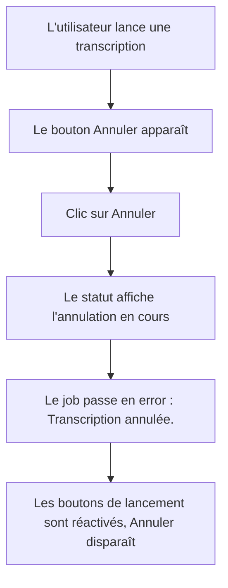
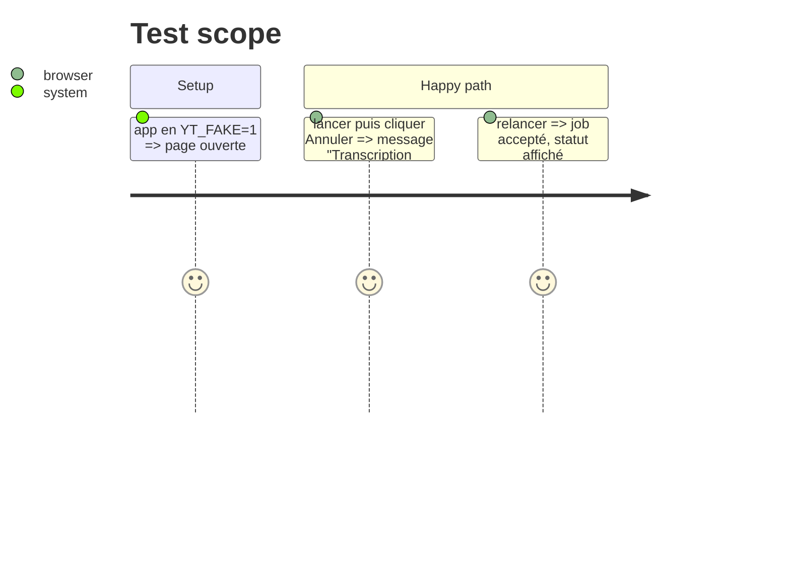

# Instruction: Bouton « Annuler » de la page et scénario e2e

## Architecture projection

> Tree of the final files. ✅ create · ✏️ modify · ❌ delete

```txt
.
├── app/static/
│   ├── index.html  ✏️ bouton #cancel à côté des boutons de lancement
│   └── app.js      ✏️ setBusy affiche #cancel, clic => POST /jobs/{id}/cancel
└── e2e/
    └── test_page.py ✏️ scénario d'annulation, neuvième
```

## User Journey



## Test Scope



## Wireframe

```txt
┌──────────────────────────────────────────────────────────┐
│ [1] champ URL                [2] Transcrire [2] Slides   │
│                              [3] Annuler                 │
│ [4] ligne de statut                                      │
│ [5] ligne d'erreur                                       │
└──────────────────────────────────────────────────────────┘
1. champ URL existant
2. boutons de lancement existants, désactivés pendant un job
3. bouton d'annulation, présent seulement pendant un job
4. statut existant
5. erreur existante, role="alert"
```

## Tasks to do

### `1)` Bouton d'annulation

> L'utilisateur arrête le job en cours depuis la page.

1. `index.html` : `<button id="cancel" type="button" hidden>Annuler</button>`, tokens de `design.md` (bordure `danger` sur `surface` ou style secondaire existant, contraste vérifié).
2. `app.js` : `setBusy` bascule `hidden` de `#cancel`. Le clic lit l'id retenu, envoie `POST /jobs/{id}/cancel`, affiche « Annulation… » dans le statut. Le polling existant montre l'erreur finale.
3. Un `404` ou `409` sur cancel ne casse pas la page : le polling continue de faire foi.

### `2)` Scénario e2e

> L'annulation est vérifiée dans un vrai navigateur.

1. `e2e/test_page.py` : lancer, cliquer « Annuler », attendre « Transcription annulée. » dans `#error`, puis relancer et voir le statut avancer.
2. `scripts/e2e.sh fake` vert.

## Test acceptance criteria

| Task | Acceptance criteria |
| ---- | ------------------- |
| 1 | « Annuler » n'est visible que pendant un job, et un clic termine le job en `error` avec « Transcription annulée. » |
| 2 | après l'annulation, une nouvelle transcription démarre sans message de job déjà en cours |
