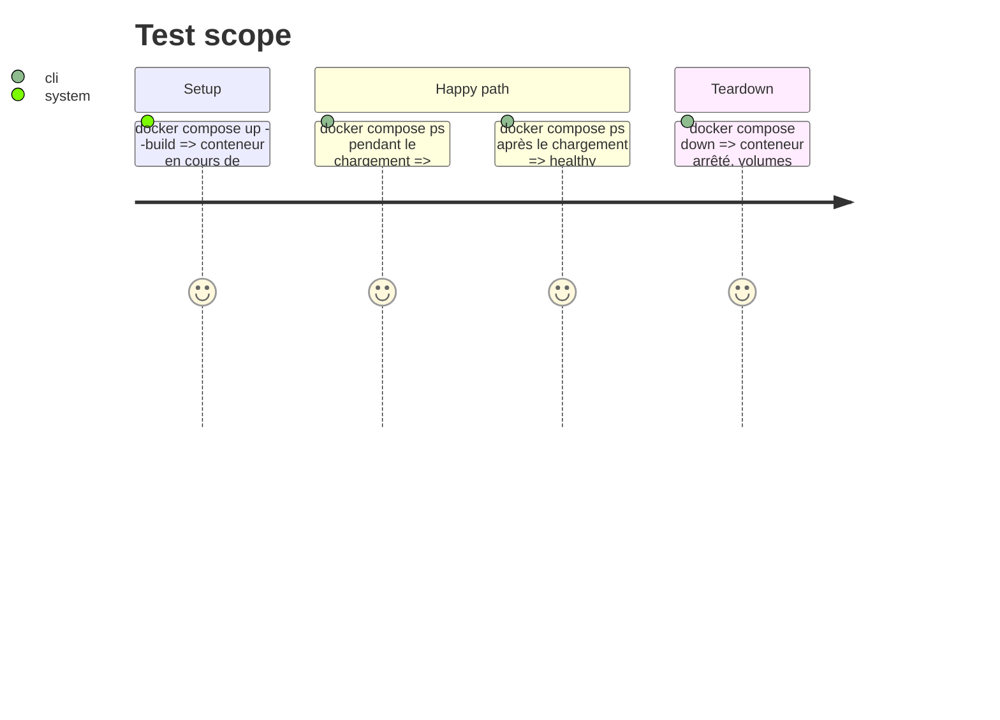

# Instruction: Healthcheck Compose, mémoire et README

## Architecture projection

> Tree of the final files. ✅ create · ✏️ modify · ❌ delete

```txt
.
├── compose.yaml   ✏️ healthcheck sur GET / en Python
├── README.md      ✏️ annulation, limite, directs, healthy, code 409 de cancel
└── aidd_docs/memory/
    ├── api.md          ✏️ route cancel, refus des directs, limite
    ├── architecture.md ✏️ limite, annulation coopérative, healthcheck
    ├── deployment.md   ✏️ healthcheck
    ├── testing.md      ✏️ neuf scénarios e2e
    ├── forms.md        ✏️ bouton Annuler
    └── design.md       ✏️ style du bouton Annuler si un token nouveau sert
```

## Test Scope



## Tasks to do

### `1)` Healthcheck

> Compose sait quand le modèle est chargé.

1. `compose.yaml` : `healthcheck.test` en `python -c` avec `urllib.request.urlopen("http://localhost:8000/", timeout=4)`, `interval: 30s`, `timeout: 5s`, `retries: 3`, `start_period: 10m`, `start_interval: 5s` si la version de Compose le lit.
2. Mesurer avec `docker compose up --build -d` puis `docker compose ps` : `starting` avant la ligne de démarrage d'uvicorn, `healthy` après.

### `2)` Mémoire et README

> Rien de ce qui est écrit ne devient faux.

1. Mettre à jour les fichiers de `aidd_docs/memory/` listés ci-dessus et le README (section API, « Piloter l'app depuis un agent », tableau des codes).
2. Ne pas toucher `aidd_docs/memory/README.md`, dont une modification sans rapport est indexée sur `main`.

## Test acceptance criteria

| Task | Acceptance criteria |
| ---- | ------------------- |
| 1 | `docker compose ps` affiche `healthy` seulement après le chargement du modèle |
| 2 | la mémoire et le README décrivent la limite, l'annulation, le refus des directs et le healthcheck |
