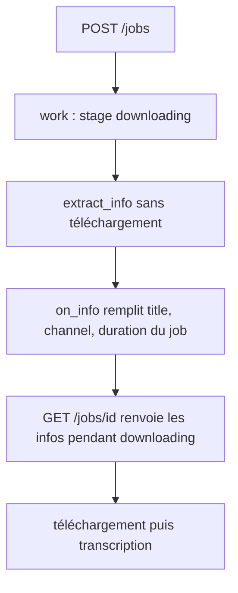
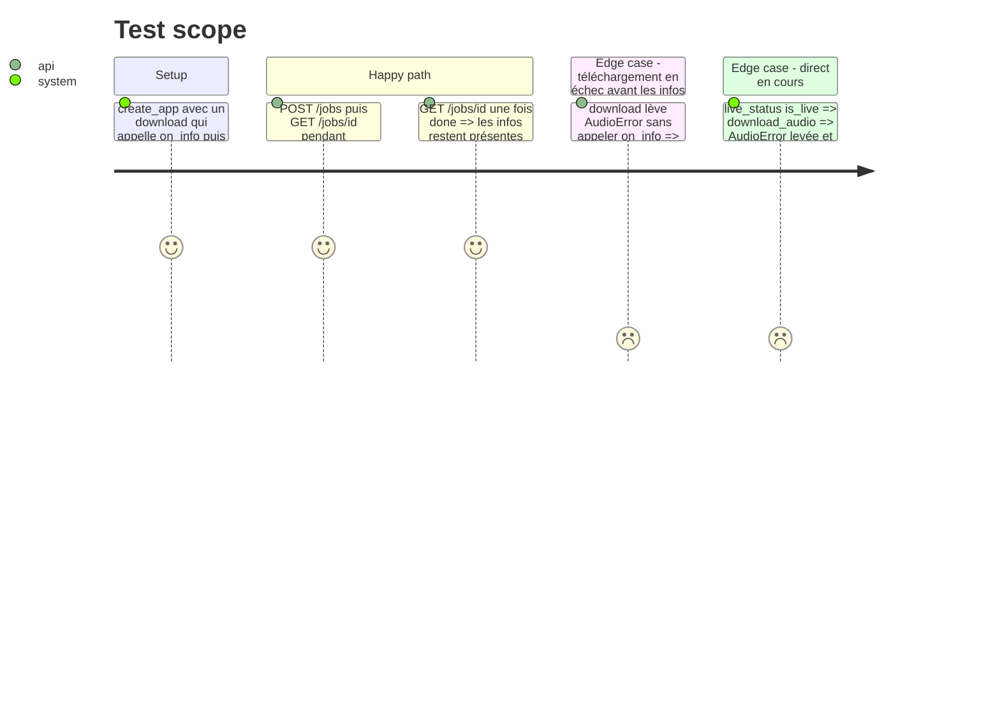

# Instruction: Infos vidéo publiées par le job dès l'extraction des métadonnées

## Architecture projection

> Tree of the final files. ✅ create · ✏️ modify · ❌ delete

```txt
.
├── app/
│   ├── audio.py        ✏️ callback on_info entre extract_info et process_ie_result
│   ├── jobs.py         ✏️ champs title, channel, duration du Job, publiés par view(), JobStore.set_info
│   ├── main.py         ✏️ work passe on_info au téléchargement
│   ├── contract.py     ✏️ JobView gagne title, channel, duration (nullable)
│   └── fake.py         ✏️ fake_download accepte et appelle on_info
└── tests/
    ├── test_audio.py   ✏️ on_info appelé avant le téléchargement, pas pour un direct refusé
    ├── test_jobs.py    ✏️ fake_download et fakes failing acceptent on_info, nouveau test
    ├── test_contract.py ✏️ fakes failing adaptés
    ├── test_runs.py    ✏️ fakes failing adaptés
    └── test_frames.py  ✏️ fakes fake_download adaptés si appelés via create_app
```

## User Journey



## Test Scope



## Tasks to do

### `1)` Callback des métadonnées dans le téléchargement

> `download_audio` signale titre, chaîne et durée avant de télécharger.

1. [x] Ajouter `on_info: Callable[[str | None, str | None, float | None], None] = no_info` en 4e paramètre de `download_audio`, après le contrôle du direct et avant `process_ie_result`.
2. [x] Même paramètre dans `app/fake.py:fake_download`, appelé après `check()`.
3. [x] Tests `test_audio.py` : ordre d'appel et absence d'appel pour un direct.

### `2)` Infos dans le job

> Le job garde les infos et les publie.

1. [x] `Job` gagne `title: str | None = None`, `channel`, `duration: float | None`, ajoutés à `view()`.
2. [x] `JobStore.set_info(job, title, channel, duration)` sous le verrou.
3. [x] `work` appelle `download(url, Path(tmp), job.check, lambda t, c, d: store.set_info(job, t, c, d))`.
4. [x] `JobView` de `app/contract.py` gagne les trois champs, `str | None` et `float | None` (secondes).
5. [x] Adapter toutes les fakes de téléchargement des tests à la nouvelle signature, `fake_download` de `tests/test_jobs.py` appelle `on_info`.
6. [x] Test : infos visibles pendant `downloading` (download qui attend un gate après `on_info`), et `null` pour un échec avant les infos.

## Test acceptance criteria

| Task | Acceptance criteria |
| ---- | ------------------- |
| 1 | `download_audio` appelle `on_info` avec titre, chaîne (ou uploader) et durée avant tout téléchargement, jamais pour un direct en cours |
| 2 | `GET /jobs/{id}` renvoie `title`, `channel`, `duration` dès l'étape `downloading`, `null` avant, et le corps valide `JobView` (`extra="forbid"`) |
