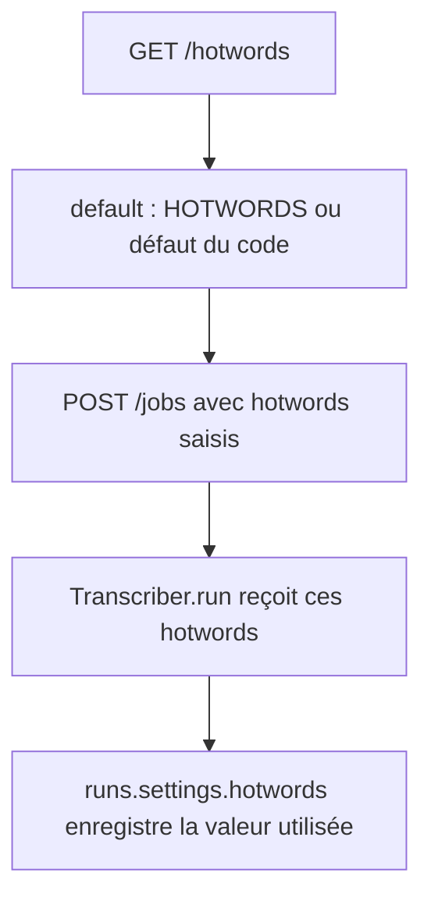
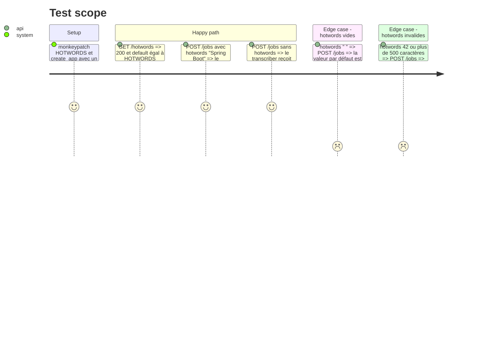

# Instruction: Hotwords par job et route de la valeur par défaut

## Architecture projection

> Tree of the final files. ✅ create · ✏️ modify · ❌ delete

```txt
.
├── app/
│   ├── transcribe.py   ✏️ run et settings prennent les hotwords du job
│   ├── main.py         ✏️ JobRequest.hotwords, validation, Job porte ses hotwords, GET /hotwords
│   ├── jobs.py         ✏️ Job.hotwords, JobStore.start(hotwords=...)
│   ├── contract.py     ✏️ modèle Hotwords {default}
│   └── fake.py         ✏️ FakeTranscriber.run accepte hotwords
└── tests/
    ├── test_jobs.py    ✏️ FakeTranscriber (et variantes) accepte hotwords, tests du champ
    ├── test_runs.py    ✏️ settings.hotwords du run suit le job
    └── test_contract.py ✏️ EXPECTED gagne GET /hotwords, corps validé
```

## User Journey



## Test Scope



## Tasks to do

### `1)` Hotwords passés au transcriber

> La transcription utilise les hotwords du job.

1. [x] `Transcriber.run(audio, on_progress, hotwords: str)` les passe à `model.transcribe`.
2. [x] `settings(hotwords)` enregistre la valeur utilisée. `hotwords()` garde son rôle de valeur par défaut (`HOTWORDS` ou `DEFAULT_HOTWORDS`).
3. [x] Adapter `app/fake.py:FakeTranscriber.run` et les fakes de tests.

### `2)` Champ `hotwords` de `POST /jobs`

> Un job peut porter ses propres hotwords.

1. [x] `JobRequest.hotwords: Any = Field(None, ...)`, publié comme chaîne nullable dans le schéma, vérifié par `create_job` comme `level`.
2. [x] Normalisation : `None` ou chaîne vide après `strip()` => `hotwords()`. Non-chaîne ou plus de 500 caractères (supposé) => `422` en français.
3. [x] Le job porte la valeur (`Job.hotwords`), `work` la passe à `transcriber.run` et à `settings(...)`.

### `3)` Route `GET /hotwords`

> La page connaît la valeur par défaut.

1. [x] `GET /hotwords` => `{"default": hotwords()}`, modèle `Hotwords` dans `app/contract.py`.
2. [x] `EXPECTED` de `tests/test_contract.py` gagne `("get", "/hotwords"): {"200"}`, et le corps est validé.

## Test acceptance criteria

| Task | Acceptance criteria |
| ---- | ------------------- |
| 1 | Le transcriber reçoit les hotwords du job, et `GET /runs/{id}` montre la même valeur dans `settings.hotwords` |
| 2 | Sans champ, `null` ou vide, le job utilise `HOTWORDS`. Une valeur non textuelle ou trop longue reçoit `422` en français |
| 3 | `GET /hotwords` renvoie la valeur de `HOTWORDS` lue à l'appel, et le schéma publié la décrit |
