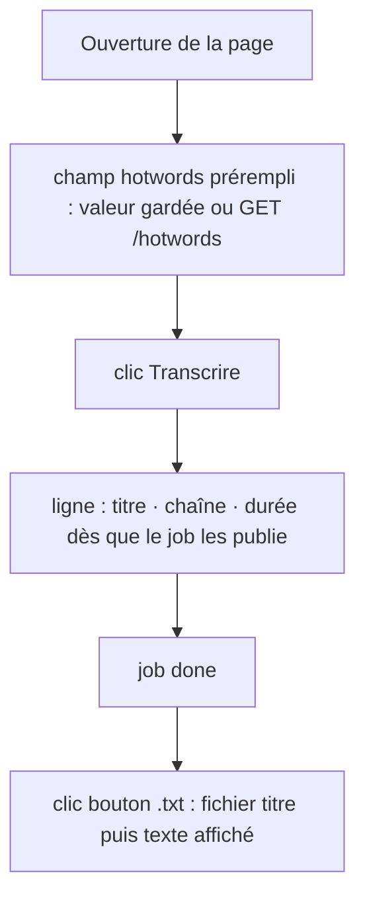
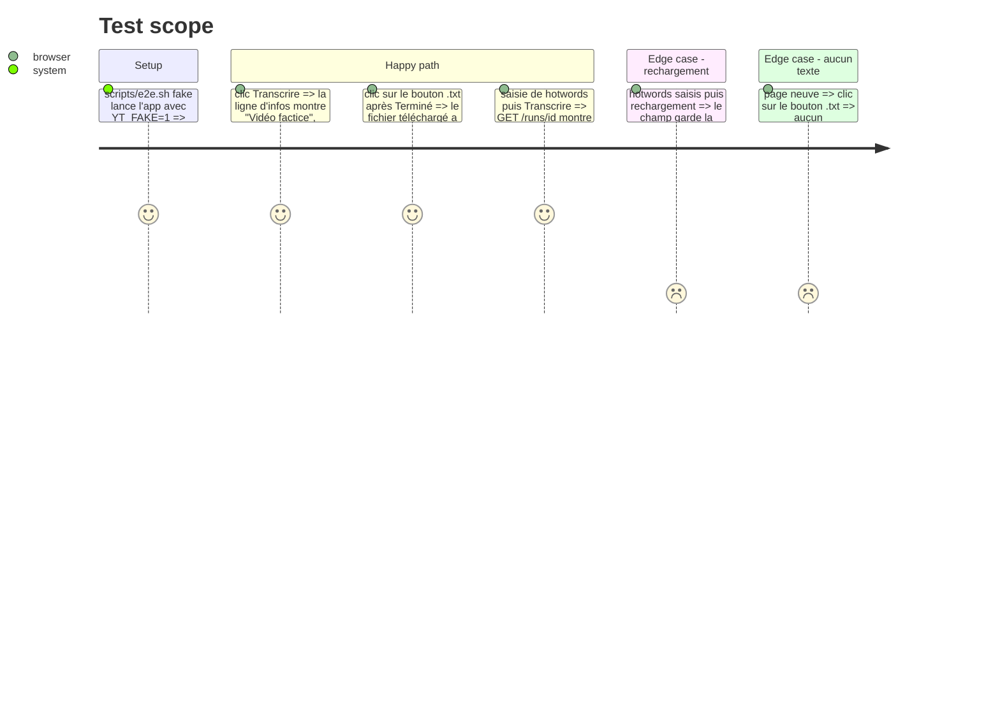

# Instruction: Page (infos, bouton `.txt`, champ hotwords), e2e, mémoire et README

## Architecture projection

> Tree of the final files. ✅ create · ✏️ modify · ❌ delete

```txt
.
├── app/static/
│   ├── index.html      ✏️ champ hotwords, ligne d'infos vidéo, bouton .txt
│   └── app.js          ✏️ préremplissage et mémorisation des hotwords, affichage des infos, export .txt
├── tests/test_static.py ✏️ si les tests vérifient les éléments de la page
├── e2e/test_page.py    ✏️ scénarios infos vidéo, export .txt, hotwords envoyés
├── README.md           ✏️ section Réglages et usage de la page
└── aidd_docs/memory/
    ├── api.md          ✏️ infos du job, champ hotwords, GET /hotwords
    ├── forms.md        ✏️ champ hotwords et sa mémorisation
    ├── design.md       ✏️ bouton .txt et son aria-label
    ├── architecture.md ✏️ hotwords par job, infos avant téléchargement
    ├── project-brief.md ✏️ fonctionnalités clés
    └── testing.md      ✏️ nombre et liste des scénarios e2e
```

## User Journey



## Test Scope



## Wireframe

```txt
┌──────────────────────────────────────────────────────────┐
│ (1) yt-transcriber                              [thème]   │
├──────────────────────────────────────────────────────────┤
│ (2) [URL ..........] [Transcrire] [avec slides] [Annuler] │
│ (3) Hotwords [Claude Code, Claude, Anthropic, MCP ......] │
│ (4) statut · erreur                                       │
│ (5) Titre de la vidéo · Chaîne · 56:12                    │
│ (6) ┌──────────────────────────────── [⏱] [⬇] [⧉] ┐     │
│     │ transcription                                  │     │
│     └────────────────────────────────────────────────┘     │
└──────────────────────────────────────────────────────────┘
```

1. En-tête existant, inchangé.
2. Formulaire existant, inchangé.
3. Champ hotwords du formulaire, envoyé avec chaque job.
4. Statut et erreur existants.
5. Infos de la vidéo du job, vide tant qu'inconnues.
6. Zone de texte, avec le nouveau bouton de téléchargement entre horodatage et copie.

## Tasks to do

### `1)` Infos vidéo dans la page

> La page montre la vidéo dès que le job la connaît.

1. [x] Ligne `#video` sous l'erreur, remplie à chaque poll quand `job.title` est connu : titre, chaîne et durée formatée par `formatTime`. Vidée au lancement d'un job.

### `2)` Bouton `.txt`

> Un clic télécharge le texte affiché, titre en première ligne.

1. [x] Bouton icône `#download`, `aria-label` « Télécharger en .txt », mêmes classes que `#copy`, placé entre `#timestamps` et `#copy` (décaler les positions et le `pr-` de la zone de texte).
2. [x] Contenu : titre (ou l'URL du job sans titre, supposé), un saut de ligne, puis la vue affichée. Nom de fichier dérivé du titre, caractères interdits remplacés.
3. [x] Sans texte, le clic ne fait rien.

### `3)` Champ hotwords

> Les hotwords se règlent depuis la page.

1. [x] `<input id="hotwords">` avec un `<label>` visible, dans le formulaire, désactivé pendant un job.
2. [x] Prérempli avec la valeur gardée dans `localStorage` (`yt-transcriber-hotwords`), sinon avec `GET /hotwords`. Gardé à chaque soumission.
3. [x] Envoyé dans `POST /jobs` sous `hotwords`.

### `4)` E2E

> Les trois comportements sont prouvés dans le navigateur.

1. [x] Scénarios du Test Scope dans `e2e/test_page.py`, lancés par `scripts/e2e.sh fake`.

### `5)` Mémoire et README

> La documentation dit vrai.

1. [x] Mettre à jour les fichiers de `aidd_docs/memory/` de la projection et le README (réglages, usage de la page, contrat d'API).

## Test acceptance criteria

| Task | Acceptance criteria |
| ---- | ------------------- |
| 1 | Pendant le job, la page affiche titre, chaîne et durée avant « Terminé » |
| 2 | Le fichier téléchargé a le titre en première ligne et la vue affichée ensuite |
| 3 | Le champ est prérempli, garde la saisie après rechargement, et le run enregistre la valeur envoyée |
| 4 | `scripts/e2e.sh fake` passe avec les nouveaux scénarios |
| 5 | Aucune ligne de la mémoire ni du README ne contredit le nouveau comportement |
