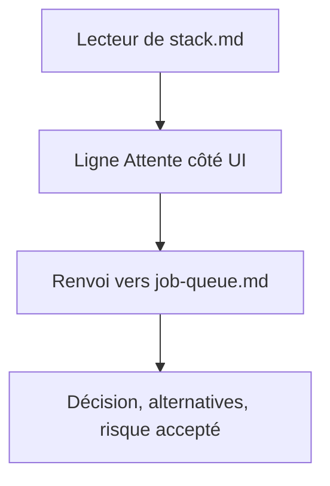
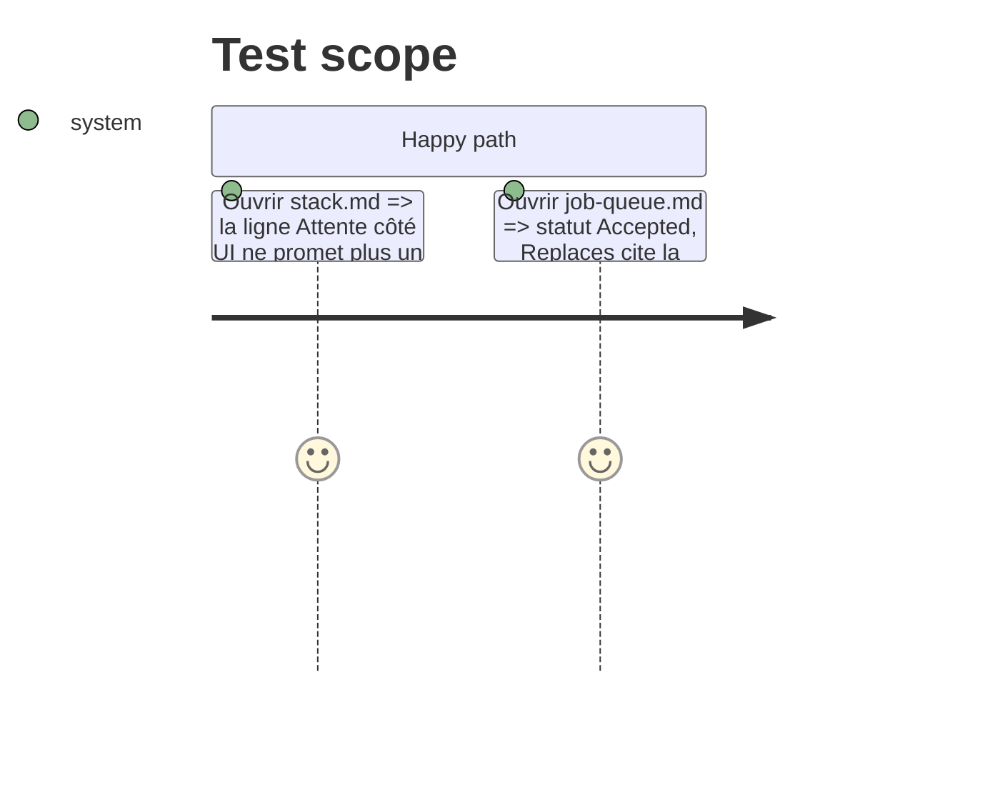

<!-- Fill or omit these sections; never add, rename, or reorder one. -->

# Instruction: ADR de la file d'attente

## Architecture projection

> Tree of the final files. ✅ create · ✏️ modify · ❌ delete

```txt
aidd_docs/memory/internal/decisions/
├── job-queue.md   ✅ nouvel ADR, remplace la promesse du 409
└── stack.md       ✏️ ligne « Attente côté UI » renvoie vers job-queue.md
CLAUDE.md          ✏️ ajoute job-queue.md à la liste des décisions
```

## User Journey



## Test Scope



## Tasks to do

### `1)` Écrire l'ADR

> Sur le modèle de `openapi-contract.md` : titre, Date 2026-10-14, Status Accepted, Replaces, Contexte, Décision, Alternatives, Risque accepté. Contenu en français.

1. Contexte : un seul GPU, le 409 oblige l'appelant (page ou skill `capture-video`) à attendre ou s'arrêter.
2. Décision : file FIFO, un worker, `queued` tant qu'il attend, horloge de la limite au démarrage réel, annulation possible en file, éviction des seuls jobs finis, file non bornée (supposé), page inchangée (supposé).
3. Alternatives : garder le 409 et laisser réessayer l'appelant, un thread par job sur un verrou (ordre non garanti), file bornée avec 409 quand pleine.
4. Risque accepté : un redémarrage perd la file entière, comme il perdait le job en cours.

### `2)` Amender `stack.md` et `CLAUDE.md`

1. Dans la ligne « Attente côté UI », remplacer « Un second job reçoit un message clair » par « Les jobs suivants attendent dans une file, voir `job-queue.md` ».
2. Ajouter `aidd_docs/memory/internal/decisions/job-queue.md` à la liste de `CLAUDE.md`.

## Test acceptance criteria

| Task | Acceptance criteria |
| ---- | ------------------- |
| 1    | `job-queue.md` existe, statut Accepted, avec les sections du modèle |
| 2    | `stack.md` ne contient plus « Un second job reçoit un message clair » |
