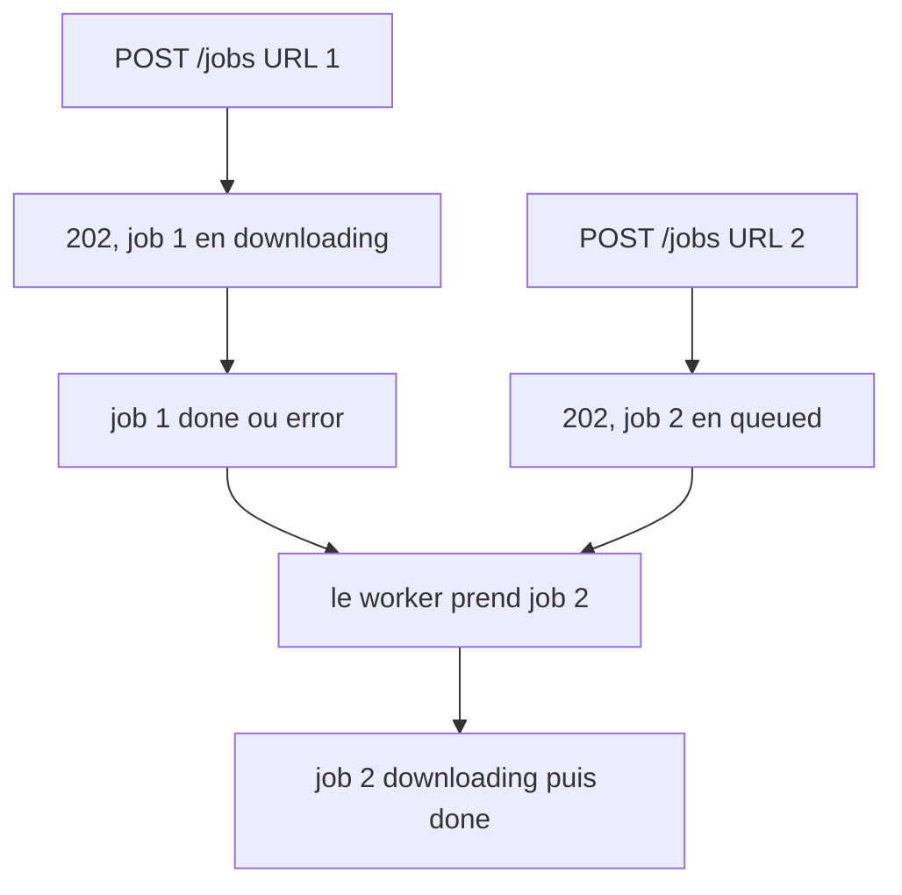
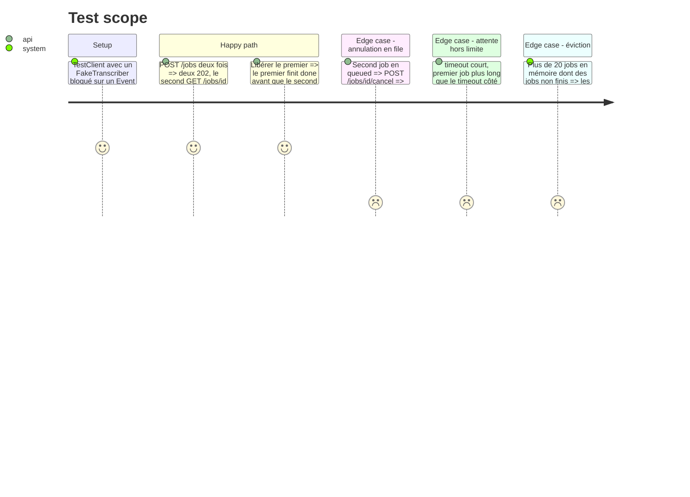

<!-- Fill or omit these sections; never add, rename, or reorder one. -->

# Instruction: file FIFO et tests

## Architecture projection

> Tree of the final files. ✅ create · ✏️ modify · ❌ delete

```txt
app/
├── jobs.py          ✏️ JobBusy supprimé, start() ne refuse plus, éviction des seuls jobs finis, Job.begin() remet l'horloge
└── main.py          ✏️ queue.Queue + un thread worker, create_job enfile, plus de 409 sur POST /jobs
tests/
├── test_jobs.py     ✏️ le test 409 devient un test d'ordre, plus annulation en file, horloge, éviction
└── test_contract.py ✏️ EXPECTED de POST /jobs sans 409, assertions 409 de POST /jobs retirées
```

## User Journey



## Test Scope



## Tasks to do

### `1)` `app/jobs.py`

> Le store n'est plus un verrou d'exclusion, il garde les jobs et leur ordre.

1. Supprimer `JobBusy` et `_active`. `start()` crée et enregistre le job sans jamais refuser.
2. Éviction : tant que plus de `_KEEP` jobs, retirer le plus ancien job **fini**. S'il n'y en a aucun, s'arrêter.
3. Ajouter `Job.begin()` (ou équivalent) qui remet `started` à `time.monotonic()`, appelé par le worker au démarrage.

### `2)` `app/main.py`

> Un consommateur unique traite les jobs dans l'ordre d'arrivée.

1. Dans `create_app`, une `queue.Queue` et un thread daemon unique qui boucle : prendre `(job, video_id, url)`, appeler `job.begin()`, puis `work(...)`.
2. `work` appelle `job.check()` avant `set_stage(DOWNLOADING)` pour qu'un job annulé en file finisse en `error` avec sa ligne `runs`, sans téléchargement. Vérifier que ce check est bien dans le `try` existant.
3. Une exception imprévue dans le worker ne tue pas la boucle (`work` attrape déjà tout, le vérifier).
4. `create_job` enfile au lieu de lancer un thread. Retirer le `409` de `responses=` et le `except j.JobBusy`.

### `3)` Tests

1. Remplacer `test_second_job_while_running_gives_409_then_frees` par un test d'ordre : deux 202, le second `queued` pendant que le premier tourne, le premier `done` avant que le second démarre (journal des appels au downloader dans l'ordre des URL), le second `done` ensuite.
2. Annulation d'un job en file : `error` « Transcription annulée. », downloader jamais appelé pour lui, `GET /runs/{id}` en `error`.
3. L'attente ne consomme pas la limite : `create_app(timeout=0.5)`, un downloader qui bloque le premier job sur un Event (sans appeler `check`) plus longtemps que le timeout. Le premier finit `error` en dépassement au checkpoint suivant, le second, qui a attendu plus que le timeout dans la file, finit `done`.
4. Éviction : unitaire sur `JobStore`, au-delà de 20 jobs dont certains non finis, ceux-ci restent dans `get()`.
5. Supprimer le test `pytest.raises(j.JobBusy)` de `tests/test_jobs.py` (ligne ~58) ou le transformer.
6. `tests/test_contract.py` : `EXPECTED[("post", "/jobs")]` devient `{"202", "422"}`, retirer l'assertion `content("/jobs", "post", "409")` et `check(client.post("/jobs"...), 409, ...)`. Le 409 de cancel reste.
7. Lancer `scripts/check.sh` jusqu'au vert.

## Test acceptance criteria

| Task | Acceptance criteria |
| ---- | ------------------- |
| 1    | `JobStore.start()` n'échoue jamais, l'éviction garde les jobs non finis |
| 2    | un second `POST /jobs` répond 202 pendant qu'un job tourne, `/openapi.json` ne publie plus de 409 sur `POST /jobs` |
| 3    | `scripts/check.sh` passe, avec les tests d'ordre, d'annulation en file, d'horloge et d'éviction |
