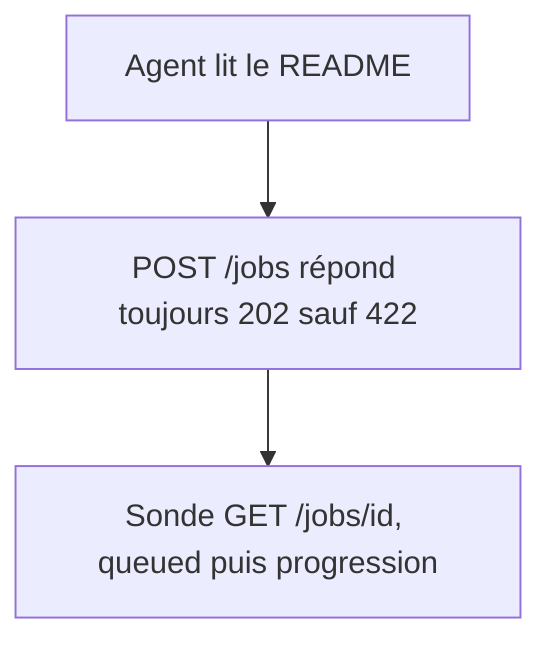
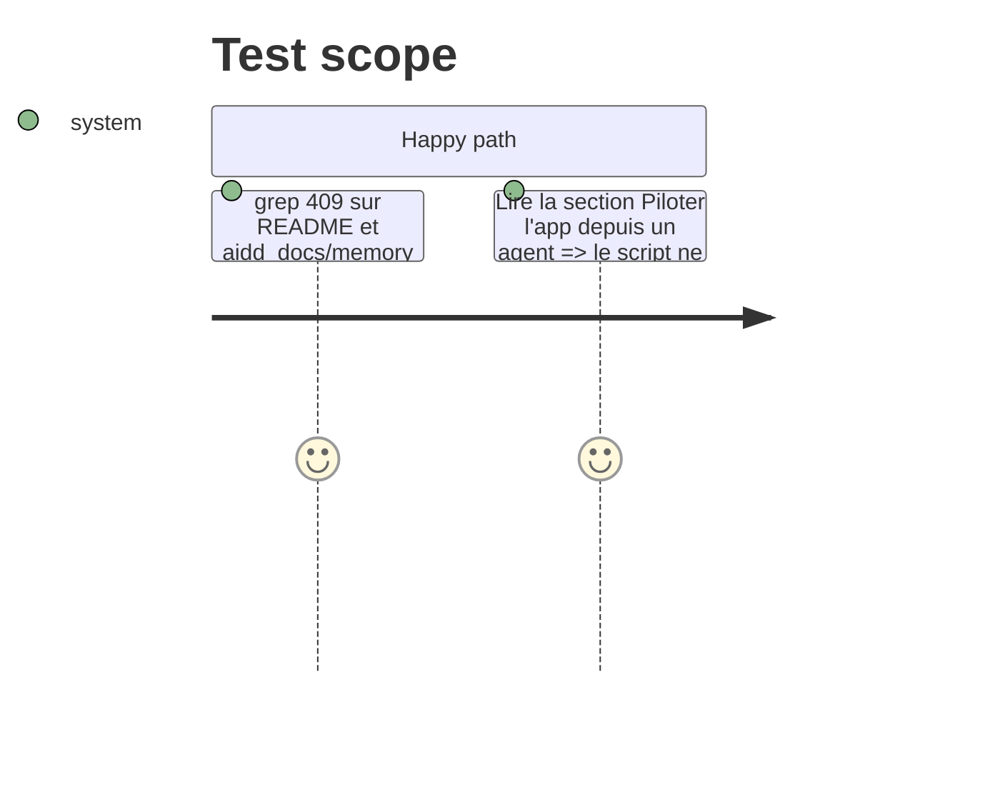

<!-- Fill or omit these sections; never add, rename, or reorder one. -->

# Instruction: mémoire et README

## Architecture projection

> Tree of the final files. ✅ create · ✏️ modify · ❌ delete

```txt
README.md                          ✏️ lignes 21, 80, 105, 130, 159 qui citent le 409 de POST /jobs
aidd_docs/memory/
├── api.md                         ✏️ ligne « A second POST /jobs gets 409 », « frees the lock »
├── architecture.md                ✏️ « The second request gets 409 », schéma et décisions
├── project-brief.md               ✏️ « One job at a time, a second request gets a clear message »
└── testing.md                     ✏️ exemple de nom de test qui cite le 409
```

## User Journey



## Test Scope



## Tasks to do

### `1)` README

1. Ligne 21 : un job à la fois, les suivants attendent leur tour dans une file.
2. Ligne 80 et tableau ligne 105 : retirer le 409 de `POST /jobs`, dire que le job attend en `queued`.
3. Script ligne 130 : « 202 donne l'id, 422 arrête », et adapter le code du script s'il teste le 409.
4. Ligne 159 : la mesure du 13 octobre citait un 409. La garder datée en la marquant historique, ou la retirer, sans inventer de nouvelle mesure.

### `2)` Mémoire

1. `api.md`, `architecture.md`, `project-brief.md`, `testing.md` : remplacer chaque phrase que la file rend fausse, renvoyer vers `internal/decisions/job-queue.md`.
2. `architecture.md` : la décision « One job at a time » décrit la file, le worker unique et l'horloge au démarrage.

## Test acceptance criteria

| Task | Acceptance criteria |
| ---- | ------------------- |
| 1    | le README ne promet plus de 409 sur `POST /jobs` |
| 2    | aucun fichier de `aidd_docs/memory/` ne promet de 409 sur `POST /jobs` |
