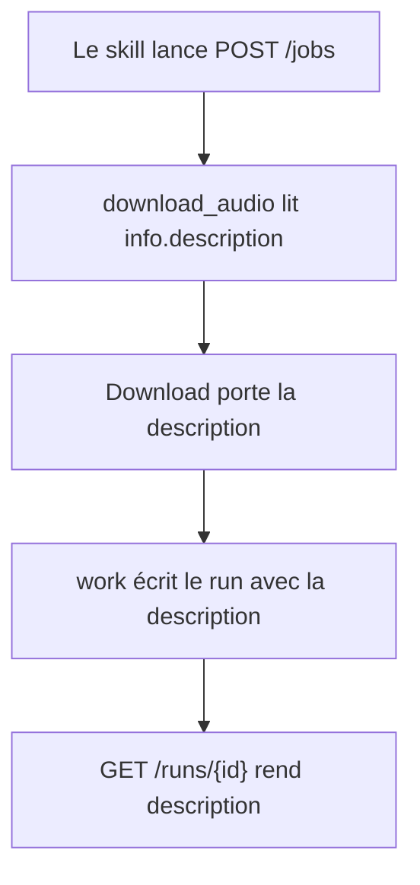
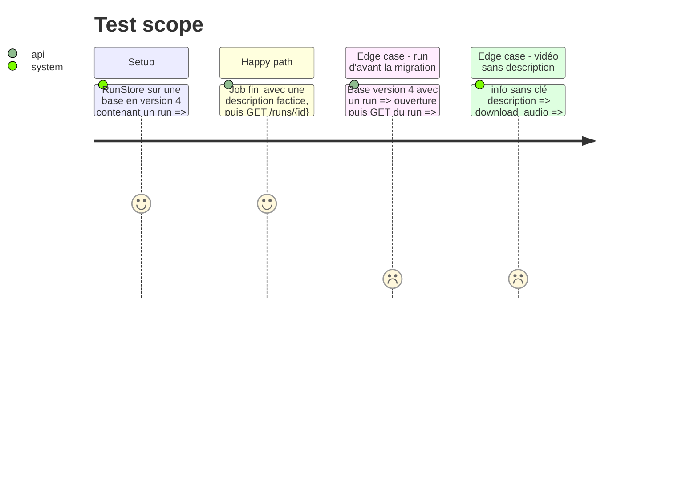

<!-- Fill or omit these sections; never add, rename, or reorder one. -->

# Instruction: description du téléchargement jusqu'au run

## Architecture projection

> Tree of the final files. ✅ create · ✏️ modify · ❌ delete

```txt
.
├── app/
│   ├── audio.py        ✏️ Download.description, lue dans info
│   ├── fake.py         ✏️ FAKE_DESCRIPTION passée par fake_download
│   ├── main.py         ✏️ runs.record(description=...)
│   ├── runs.py         ✏️ SCHEMA_VERSION 5, _DESCRIPTION_SCHEMA, colonne dans _COLUMNS
│   └── contract.py     ✏️ Run.description
├── tests/
│   ├── test_audio.py   ✏️ la description sort du téléchargement
│   ├── test_runs.py    ✏️ migration 4 vers 5, version attendue 5
│   ├── test_jobs.py    ✏️ GET /runs/{id} rend la description
│   ├── test_fake.py    ✏️ si une assertion porte sur le Download factice
│   └── test_contract.py ✏️ si EXPECTED ou un corps réel l'exige
├── aidd_docs/memory/
│   ├── api.md          ✏️ la description dans « What the schema does not say »
│   ├── architecture.md ✏️ schema version 5
│   └── internal/decisions/run-storage.md ✏️ la colonne description
└── README.md           ✏️ seulement si une phrase devient fausse
```

## User Journey



## Test Scope



## Tasks to do

### `1)` Lire la description au téléchargement

> `download_audio` rend la description que `extract_info` lit déjà.

1. Ajouter `description: str | None = None` à `Download` (`app/audio.py`).
2. La remplir avec `info.get("description")` dans le `Download` rendu. Ne pas toucher `on_info`.
3. `app/fake.py` : constante `FAKE_DESCRIPTION` en français, passée au `Download` factice.
4. Test dans `tests/test_audio.py` : description présente, et `None` quand la clé manque.

### `2)` Stocker la description dans le run

> Une colonne nullable, ajoutée par une migration version 5.

1. `app/runs.py` : `_DESCRIPTION_SCHEMA = "ALTER TABLE runs ADD COLUMN description TEXT"`, étape `if version < 5`, `SCHEMA_VERSION = 5`, `"description"` dans `_COLUMNS`, pas dans `_SUMMARY_COLUMNS`.
2. `app/main.py` : `runs.record(..., description=meta.description if meta else None)`.
3. `tests/test_runs.py` : les assertions `user_version == 4` passent à 5. Ajouter un test de migration d'une base version 4 avec un run, qui se relit avec `description` à `None`.

### `3)` Publier la description dans le contrat

> `GET /runs/{id}` publie le champ dans `/openapi.json`.

1. `app/contract.py` : `description: str | None = Field(description="Video description as YouTube shows it, null for a run recorded before it was stored.")` dans `Run`, après `video_duration`.
2. `tests/test_jobs.py` : un job fini avec le téléchargement factice rend sa description dans `GET /runs/{id}`.
3. Faire passer `tests/test_contract.py` (validation `extra="forbid"` des corps réels).

### `4)` Garder la mémoire vraie

> Les documents disent ce que le code fait.

1. `aidd_docs/memory/api.md` : une ligne sous « What the schema does not say » : la description vient du même `extract_info`, elle est sur `GET /runs/{id}` seulement, ni sur `GET /runs` ni sur le job, et `null` pour un run d'avant la version 5.
2. `aidd_docs/memory/architecture.md` : « schema version 4 » devient 5.
3. `aidd_docs/memory/internal/decisions/run-storage.md` : citer la description dans la ligne `runs` du tableau et #72 dans la liste des issues porteuses.
4. Relire `README.md` et corriger seulement une phrase devenue fausse.

## Test acceptance criteria

| Task | Acceptance criteria |
| ---- | ------------------- |
| 1 | `download_audio` rend la description de `info`, ou `None` sans clé |
| 2 | Une base en version 4 s'ouvre en version 5, ses runs gardés, leur description `null` |
| 3 | `GET /runs/{id}` d'un job fini porte `description`, et le corps valide contre `Run` |
| 3 | `GET /runs` ne porte pas `description` |
| 4 | Aucune phrase de `aidd_docs/memory/` ni du README ne dit « version 4 » pour le schéma courant |
| all | `scripts/check.sh` passe |
